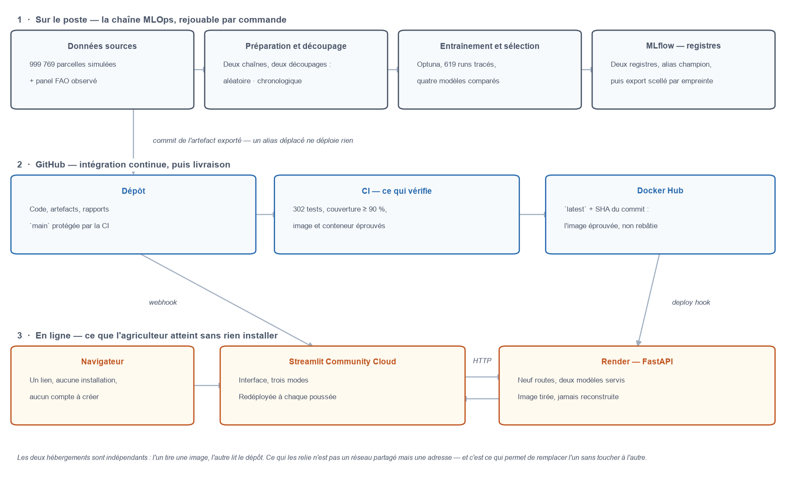
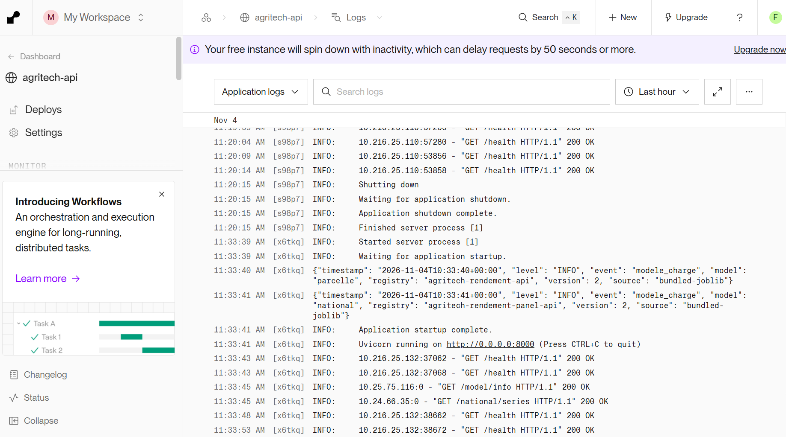

# Conclusion

*Ce chapitre clôt le dossier. Il reprend ce que les quatre parties établissent, ce qu'elles n'établissent pas, et ce qu'il faudrait pour que l'outil serve sur des exploitations réelles.*

---

## Ce qui a été livré

| | Livrable | Caractéristique principale |
|---|---|---|
| **1** | Jeu de données consolidé | 999 769 parcelles, 13 variables explicatives et la cible |
| | Référentiel par culture, dictionnaire des variables, panel FAO | reconstructibles par une commande |
| **2** | Modèle de prédiction | régression régularisée, 0,40 t/ha d'erreur absolue moyenne |
| | Second modèle, sur le panel FAO | rendements nationaux observés, prolongés d'une année |
| | Journal d'expériences | 619 runs sur deux expériences, métriques et paramètres tracés |
| **3** | API de prédiction | neuf routes, **deux modèles servis**, contrat typé, journal des appels |
| | Artefacts de service | prétraitement et modèle gelés ensemble, scellés par une empreinte |
| | Image conteneurisée | autonome, sans registre ni base de données |
| **4** | Interface utilisateur | trois parcours, aucune logique métier côté écran |
| **5** | Chaîne d'industrialisation | documentée dans le `README.md` du dépôt |
| | Déploiement public | API et interface en ligne, redéployées par la chaîne de livraison |

La chaîne est complète : des six fichiers sources à une application qu'un agriculteur peut ouvrir dans son navigateur, chaque maillon se rejoue par une commande.

---

## La mise en production

*Trois bandes, et une seule frontière qui compte : celle du milieu. Rien ne passe du poste à la production sans traverser un commit — déplacer un alias dans MLflow ne déploie rien, et le schéma ne propose aucune flèche qui contourne le dépôt. En bas, les deux hébergements sont indépendants : l'un tire une image, l'autre lit le dépôt.*

L'API est servie depuis l'**image déjà éprouvée** par la chaîne d'intégration : l'hébergeur tire celle qui a passé les tests, aucune reconstruction n'intervient. Mais un service bâti sur une image ne surveille pas le registre — il faut le lui dire. La chaîne appelle donc son *deploy hook* après la publication, et la livraison va du commit au service sans intervention manuelle.

L'interface est déployée depuis le dépôt et se met à jour à chaque poussée. Les deux composants restent indépendants — l'un en conteneur, l'autre non — et ne sont reliés que par une adresse.

**Le journal écrit à deux destinations, qui ne portent pas la même chose.** Le tampon en mémoire garde les corps complets pour la route `/logs`, et disparaît à chaque redémarrage — c'est-à-dire souvent, puisque le service s'endort. La sortie standard ne reçoit que les métadonnées — route, méthode, statut, durée, identifiant d'appel — mais l'hébergeur les conserve plusieurs jours. La répartition est un choix de sécurité, non de confort : les corps de `/recommend` contiennent les prix et les charges de l'appelant, et les déverser dans un tableau de bord les y exposerait une semaine durant.

*Les deux lignes `modele_charge` annoncent chacune leur artefact, sa version et sa provenance : c'est ce qui permet de savoir après coup quel modèle servait au moment d'un incident. Un échec de chargement serait consigné de la même façon, **avant** que le processus ne s'arrête — c'est la seule trace possible dans ce cas, puisqu'un conteneur qui refuse de démarrer ne répond à aucune route, pas même à sa propre sonde de santé.*

---

## Ce que le projet établit

**Les deux jeux de données ne se joignent pas.** Aucun identifiant ne les relie : les parcelles n'ont ni pays ni année. Le référentiel FAO a donc été construit comme un enrichissement par culture, et non comme une fusion géographique. Cette contrainte a déterminé tout le reste.

**Le modèle le plus simple l'emporte.** Deux modèles capables de capter des interactions ne trouvent rien que la régression additive ne capte déjà. Sur ces données, le rendement se décompose en contributions indépendantes.

**Les six cultures ne se départagent pas sur le rendement.** À conditions de parcelle identiques, l'écart entre la meilleure et la pire vaut 6,5 kg/ha — quinze fois moins que le seuil de pertinence pratique retenu. Retirer l'information « culture » du modèle ne dégrade pas la prédiction. C'est le résultat central du projet, et il va à l'encontre de la demande initiale.

**Quatre variables portent la totalité du signal** : la pluviométrie d'abord, puis la fertilisation, l'irrigation et la température. Les neuf autres — type de sol, région, météo, indicateurs de référence — pèsent quelques kilogrammes par hectare, soit un facteur 500 à 2 500 d'écart.

**C'est l'économie qui départage les cultures, pas l'agronomie.** Les six rendements étant pratiquement identiques, seule la marge brute — prix × rendement − charges — les sépare. D'où le choix de servir des prix de référence sourcés et de demander les charges à l'utilisateur plutôt que de les inventer.

---

## Ce que le projet n'établit pas

**Aucun résultat agronomique.** Les données de parcelles sont simulées : variables parfaitement uniformes, modalités rigoureusement équilibrées, relations d'une régularité qu'on n'observe jamais au champ. Le modèle retrouve d'ailleurs presque exactement la formule qui a servi à les générer. Les contributions chiffrées décrivent ce générateur, pas une agronomie.

**Aucun effet causal.** Que le modèle attribue +1,50 t/ha à la fertilisation ne démontre pas qu'épandre de l'engrais sur une parcelle réelle relèverait son rendement d'autant. Les données permettent ici une lecture en termes de levier — les parcelles fertilisées et non fertilisées ne diffèrent par rien d'autre, à 0,13 % près — mais cette propriété tient au caractère simulé du jeu, et ne se transposerait pas.

**Aucune garantie de performance en production.** Le jeu de test mesure la généralisation à des données issues de la même distribution simulée. Rien n'assure que des parcelles réelles lui ressemblent.

**Aucune équivalence statistique entre cultures.** Le seuil de 0,1 t/ha est une convention de décision annoncée, pas un test de significativité. Le dossier affirme que l'écart est pratiquement négligeable, jamais que les cultures sont statistiquement indiscernables.

---

## Ce qu'il faudrait pour un usage réel

Quatre conditions, par ordre d'importance.

**Des données observées.** C'est la condition dont dépendent toutes les autres. Tant que l'entraînement porte sur un jeu simulé, les chiffres du modèle décrivent un générateur. Des relevés de terrain changeraient la nature même du produit — et c'est seulement alors que l'absence d'effet du sol, de la région ou de la culture pourrait être interprétée.

**Des charges territorialisées.** Les prix servis sont des médianes mondiales, d'assise inégale — 11 pays déclarants pour le coton, 75 pour le maïs. Les charges, elles, n'ont aucune source : l'application les demande à l'utilisateur. Des références technico-économiques régionales rendraient la comparaison économique défendable au lieu d'illustrative.

**Une véritable authentification.** La route `/logs` rend les budgets transmis par les utilisateurs — leurs prix et leurs charges. Le dossier identifiait là sa limite la plus urgente ; la mise en ligne l'a rendue concrète, et elle est désormais fermée par une clé exigée dans l'en-tête `X-API-Key`, activée par variable d'environnement sur le déploiement public. Mais une clé unique et partagée ne distingue pas ses porteurs, ne trace pas qui a lu quoi, et ne se révoque qu'en bloc. C'est un verrou d'exploitation, pas un contrôle d'accès : un service réellement ouvert demanderait des comptes, des rôles et une journalisation des consultations.

**Un hébergement qui ne dort pas.** L'outil est désormais en ligne et ne demande plus rien à installer, mais sur des offres gratuites : le service s'endort après quinze minutes sans visite, et la première requête attend près d'une minute pendant qu'il se réveille. L'interface absorbe cette attente en réessayant d'elle-même, et l'annonce plutôt que de laisser un écran vide — mais une minute avant le premier chiffre reste incompatible avec un usage régulier.

---

## Ce que le prototype démontre malgré tout

Il démontre une chaîne, et la discipline qui la tient.

Le dossier montre un projet où **une demande a été contredite par les données** — on attendait un classement de cultures, les données n'en portent aucun — et où cette contradiction a été établie, mesurée, puis assumée dans le produit plutôt que masquée par un classement de bruit. L'application affiche d'ailleurs elle-même la réserve, plutôt que de laisser croire à une hiérarchie.

Il montre aussi que chaque chiffre servi est rattachable à ce qui l'a produit : l'empreinte des données, celle du découpage, la version du modèle, celle des hypothèses économiques. Une prédiction rendue aujourd'hui peut être reliée au jeu de données exact qui l'a permise.

C'est ce que doit démontrer un prototype MLOps : non pas qu'un modèle prédit bien, mais qu'on sait **ce qu'il prédit, sur quoi, et avec quelles réserves**.
