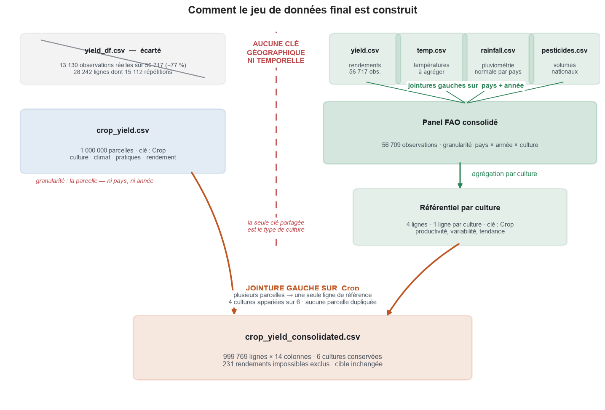
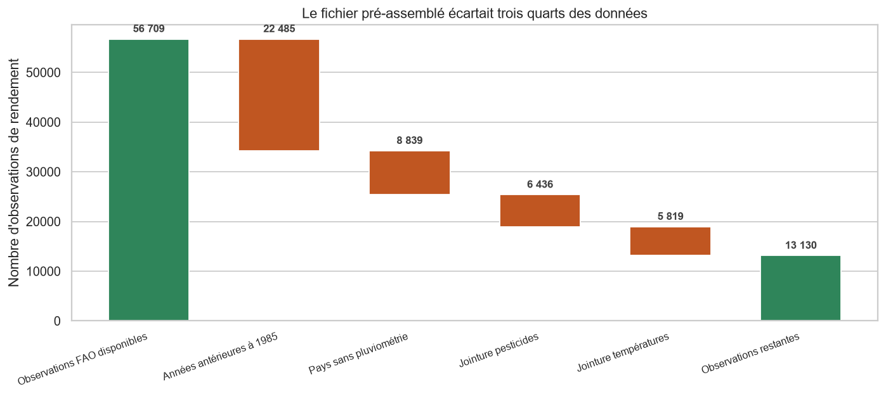
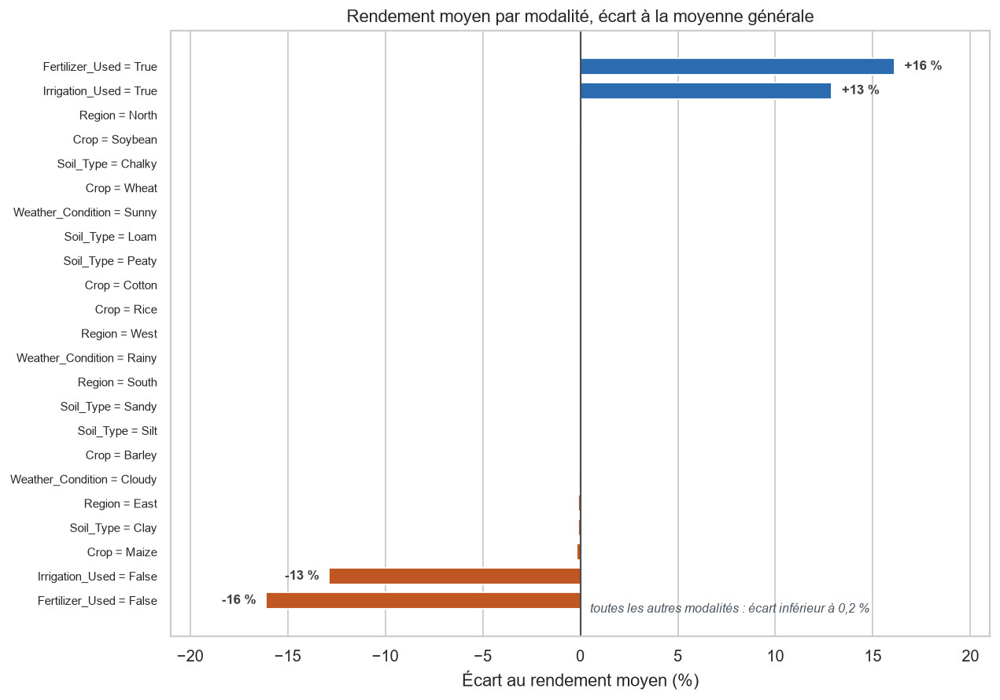
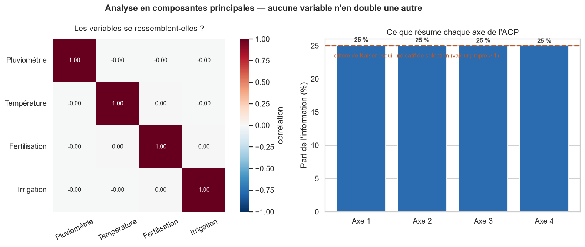

# Étape 1 — Préparation des données : choix réalisés et variables clés

*Document de travail destiné à alimenter le rapport métier final. Rédigé pour un lecteur non technique.*

---

## 1. Ce que contiennent les données fournies

L'archive contient **six fichiers**, et non deux comme annoncé : les deux jeux de données décrits dans la commande, plus les quatre fichiers bruts qui ont servi à construire le second.

| Jeu | Volume | Ce qu'une ligne représente |
|---|---|---|
| **Données de parcelles** | 1 000 000 lignes | Une parcelle : sa culture, son climat, ses pratiques, son rendement |
| **Référentiel agricole FAO** | 56 717 lignes | Un pays, une culture, une année |

Ces deux ensembles décrivent des réalités différentes. Les parcelles sont des observations individuelles ; le référentiel FAO agrège des moyennes nationales annuelles.

**Point déterminant pour la suite : le fichier des parcelles ne contient ni pays ni année.** Ses « régions » sont quatre zones génériques — Nord, Sud, Est, Ouest — sans correspondance avec un territoire réel.

---

## 2. La décision majeure : il n'y a pas eu de fusion au sens attendu

### Pourquoi une fusion classique était impossible

Rapprocher deux jeux de données suppose un identifiant commun. Ici, il n'y en a aucun : les parcelles n'ont ni localisation ni date, le référentiel FAO est organisé par pays et par année. Aucune parcelle ne peut donc être rattachée à un pays ou à une année particulière.

**La seule information partagée est le type de culture.**

### Ce qui a été fait à la place

Nous avons construit un **référentiel par culture** à partir des données FAO — productivité relative, niveau de rendement de référence, variabilité entre pays, progression historique — puis nous l'avons rattaché à chaque parcelle via sa culture.

C'est un **enrichissement documentaire**, pas une fusion géographique. La distinction est importante : une parcelle enrichie ne porte aucune information sur un pays ou une année. Présenter l'opération comme une fusion laisserait croire à une précision qui n'existe pas.

*Le trait rouge sépare deux mondes qui ne partagent **ni pays ni année**. À droite, les quatre sources FAO se combinent normalement sur « pays + année », puis sont agrégées en une table de quatre lignes — une par culture. À gauche, le million de parcelles. La seule clé partagée étant le type de culture, les deux branches convergent par une **jointure gauche sur `Crop`** : plusieurs parcelles pointent vers une même ligne de référence, aucune n'est dupliquée. Le résultat est le fichier unique livré en bas.*

### Un choix de source qui change les résultats

La commande désignait un fichier pré-assemblé par le fournisseur des données. Nous avons vérifié comment il avait été construit, et nous ne l'avons **pas retenu**. Trois raisons :

| Constat | Conséquence |
|---|---|
| Sa construction a écarté **77 % des observations de rendement disponibles** | Couverture réduite de 212 à 101 pays |
| **Plus de la moitié de ses lignes sont des répétitions** | 28 242 lignes pour 13 130 observations réelles |
| Les répétitions sont **très inégales selon les pays** | L'Inde représente 14 % des lignes pour 1,4 % des observations réelles |

La première cause de ces pertes est une simple question de calendrier : les rendements FAO commencent en 1961, les relevés de pluviométrie en 1985. Près de 40 % des observations ont disparu pour cette seule raison — au profit de deux variables dont l'exploitation reste très limitée : la pluviométrie fournie est une moyenne figée par pays, identique d'une année à l'autre, et les pesticides sont un volume national sans rapport avec une dose appliquée à une parcelle.

*Chaque barre orange est une jointure qui élimine des observations de rendement. Aucune n'est due à une donnée de mauvaise qualité : ce sont des exclusions par construction, faute de correspondance dans les fichiers annexes.*

En repartant du fichier source plutôt que de sa version assemblée, nous disposons de **3,9 fois plus d'observations**, du double de pays et de 56 années d'historique au lieu de 24.

### Un piège statistique évité

En comparant les cultures entre elles, un classement établi sur les moyennes mondiales plaçait le blé devant le maïs. Or, **au sein de chaque pays cultivant les deux, c'est l'inverse**.

L'explication est une question de composition : le blé est davantage cultivé dans des pays à agriculture intensive, ce qui gonfle sa moyenne mondiale sans que la culture soit intrinsèquement plus productive. Notre indice est donc calculé **à l'intérieur de chaque pays**, ce qui réduit ce biais — sans toutefois l'annuler complètement, les périodes et les systèmes agricoles restant hétérogènes.

### Les variables ajoutées

**Cinq variables** ont été créées et figurent au jeu de données livré :

| Variable | Ce qu'elle apporte |
|---|---|
| Indice de productivité par culture | Hiérarchie des cultures, corrigée du biais de composition |
| Variabilité entre pays | Régularité du rendement d'une culture selon les pays |
| Progression historique | Tendance du rendement sur six décennies |
| Présence au référentiel | Signale les cultures sans équivalent FAO |
| Faible pluie sans irrigation | Repère les parcelles en situation défavorable |

Quatre autres ont été construites puis **écartées** : deux comparaient des grandeurs climatiques non comparables entre les deux sources, deux faisaient double emploi avec celles retenues. Elles restent disponibles dans le référentiel, sans encombrer le jeu d'entraînement.

Une sixième — un **indice d'intensification** résumant fertilisation et irrigation sur une échelle de 0 à 2 — a été créée puis retirée du livrable. Elle valait exactement la somme des deux pratiques, et aurait empêché d'attribuer un effet à l'une plutôt qu'à l'autre (voir ci-dessous).

### Deux vérifications avant de livrer

**Aucune valeur extrême n'a été supprimée, et c'est un résultat.** Nous avons appliqué une recherche systématique de valeurs aberrantes à toutes les variables quantitatives des cinq fichiers. Elle ne signale rien — pour une raison structurelle : la pluviométrie et la température sont **parfaitement uniformes** (leurs déciles sont réguliers à 0,3 % près), si bien que les seuils de détection tombent en dehors même des valeurs possibles. Quant aux 28 rendements les plus élevés, ils sont exactement en nombre attendu pour un aléa normal — 2 660 observations écartées de plus de trois écarts-types, contre 2 699 attendues. **Ce sont des valeurs rares, pas des erreurs** : les retirer aurait biaisé le modèle vers la moyenne.

**Deux colonnes ont été retirées, chacune pour un motif précis.** Nous avons mesuré la redondance sur l'ensemble des variables numériques, puis étendu l'analyse aux variables qualitatives — nécessaire, car le type de culture détermine entièrement quatre des colonnes construites, ce qu'une analyse purement numérique ne voit pas.

| Colonne retirée | Motif |
|---|---|
| **Indice d'intensification** | Doublon exact de la fertilisation et de l'irrigation réunies |
| **Durée jusqu'à récolte** | Probablement inconnue de l'agriculteur au moment où il interroge l'application, pour un pouvoir explicatif nul |

Toutes les autres ont été conservées : leur utilité réelle a été **mesurée à l'entraînement**, à l'étape suivante, plutôt que présumée ici.

---

## 3. Les variables clés du rendement

### Ce qui détermine réellement le rendement

Quatre variables concentrent l'essentiel de ce qui est associé au rendement dans les données de parcelles :

| Variable | Effet mesuré |
|---|---|
| **Pluviométrie** | Le facteur le plus puissant. L'effet est régulier : chaque tranche de pluie supplémentaire apporte le même gain |
| **Fertilisation** | **+16 % de rendement** par rapport à une parcelle non fertilisée |
| **Irrigation** | **+13 % de rendement** |
| **Température** | Effet réel mais faible |

Les deux pratiques agricoles sont les seuls **leviers actionnables** par un agriculteur : ce sont elles qui porteront le message métier de l'application.

*Quatre barres se détachent — fertiliser et irriguer, dans un sens comme dans l'autre. Les dix-neuf autres situations sont collées à zéro : ni le sol, ni la région, ni la météo, ni la culture ne déplacent le rendement de plus de 0,2 %. Les barres « oui » et « non » d'une même pratique sont les deux faces d'un même constat, non deux effets distincts.*

**Peut-on en conclure que fertiliser *fait* gagner 16 % ?** Normalement non : un écart observé n'est pas une preuve d'effet, car les parcelles fertilisées pourraient différer par ailleurs. Nous l'avons vérifié — et dans ce jeu de données, elles ne diffèrent pas : entre parcelles fertilisées et non fertilisées, la pluviométrie, la température et la durée de cycle sont identiques à moins de **0,13 %** près. Tout indique une attribution aléatoire des pratiques, comme dans un essai comparatif. La lecture en termes de levier est donc défendable ici, ce qu'elle ne serait pas sur des données de terrain.

### Ce qui n'explique rien — et c'est vérifié

| Variable | Constat |
|---|---|
| Type de sol | Aucun écart mesurable entre les six types |
| Région | Aucun écart entre les quatre zones |
| Condition météo | Aucun écart entre ensoleillé, nuageux et pluvieux |
| Durée jusqu'à récolte | Aucun lien avec le rendement |
| **Culture** | **Aucun écart entre les six cultures** |

Ces constats ne reposent pas sur une impression : avec un million d'observations, le moindre écart réel aurait été détecté. Les différences observées entre cultures sont de l'ordre de 0,01 tonne par hectare, soit exactement ce que produit le hasard d'échantillonnage.

### L'analyse en composantes principales (ACP)

Une question restait ouverte : certaines variables **disent-elles la même chose** sous deux noms différents ? Si c'était le cas, on pourrait les remplacer par un indicateur unique et simplifier le modèle. C'est à cela que sert une ACP.

*À gauche, la ressemblance entre variables, deux à deux. Seule la diagonale est colorée — c'est-à-dire que chaque variable ne ressemble qu'à elle-même. Toutes les autres cases valent zéro. À droite, l'ACP cherche à résumer les cinq variables en un plus petit nombre d'indicateurs : elle échoue, chaque axe ne captant qu'un cinquième de l'information, soit exactement sa part si rien n'était regroupable.*

**Conclusion de l'ACP : aucune variable ne fait double emploi avec une autre.** Chacune apporte une information qui lui est propre, et il n'existe pas de résumé plus compact de ces données.

Une ACP ne détecte toutefois que les ressemblances **linéaires**. Nous avons donc complété par un contrôle direct : un modèle capable de capter n'importe quelle forme de relation a tenté de reconstituer chaque variable à partir des quatre autres. **Il échoue sur les cinq**, avec des performances nulles ou négatives. L'absence de redondance vaut donc aussi hors du linéaire, et les quatre variables clés doivent être conservées telles quelles.

Un point important sur la portée de cette analyse : **l'ACP ne regarde pas le rendement**. Elle compare les variables entre elles, pas leur lien avec ce qu'on cherche à prédire. Elle ne peut donc pas désigner à elle seule les variables importantes — elle confirme que celles identifiées plus haut ne se recoupent pas.

### Une réserve sur l'origine des données

Les données de parcelles présentent toutes les caractéristiques d'un jeu **simulé** et non collecté sur le terrain : variables parfaitement uniformes, modalités rigoureusement équilibrées, relations d'une régularité qu'on n'observe jamais en agriculture réelle.

Cela ne remet pas en cause le prototype — il démontrera la chaîne complète, de la donnée à l'application. Mais les effets chiffrés ci-dessus décrivent le comportement de ce jeu de données, et **ne doivent pas être présentés comme des résultats agronomiques** transposables à des parcelles réelles.

---

## 4. Le point dur : la recommandation de culture

### Le problème

L'application doit remplir deux fonctions. La première — estimer le rendement d'une culture dans des conditions données — ne pose pas de difficulté.

La seconde — **classer les cultures de la plus intéressante à la moins intéressante** — se heurte à un obstacle de fond : les données d'entraînement ne font aucune différence entre les cultures. Simuler les six cultures pour une même parcelle produirait six résultats identiques, et le classement affiché ne serait que du bruit.

*Attention à l'échelle : elle couvre un dixième de tonne par hectare. Les six cultures tiennent dans cet intervalle minuscule et leurs marges d'incertitude se recouvrent toutes — aucune hiérarchie fiable ne peut en être tirée.*

Nous avons cherché un effet caché de plusieurs manières : à type de sol fixé, à météo fixée, à région fixée, à pratique fixée, et par tranche de pluviométrie ou de température. **Aucun n'apparaît**, y compris avec un test statistique spécifiquement construit pour en détecter un.

Nous avons également comparé la performance d'un modèle qui mémoriserait chaque combinaison de conditions, avec et sans la culture : l'ajouter **dégrade** le résultat. Aucun des modèles et tests employés ne met en évidence d'effet exploitable de la culture. Ce n'est pas une démonstration mathématique qu'aucun modèle au monde n'y parviendrait, mais le faisceau d'indices est serré — et à ce stade, rien ne permet de fonder un classement fiable.

### Les deux voies possibles

Ce choix est **métier avant d'être technique**, et il doit être tranché avant la mise en production :

**Option A — injecter une référence externe.** Utiliser le référentiel FAO pour différencier les cultures, en assumant que la hiérarchie observée au niveau mondial s'applique aux parcelles. L'application afficherait alors un classement cohérent, mais fondé sur une **hypothèse de transfert** entre données nationales historiques et parcelles individuelles — hypothèse qu'il faudrait évaluer et signaler à l'utilisateur.

**Option B — renoncer au classement différencié.** Présenter l'application comme un estimateur de rendement, en indiquant que les données disponibles ne permettent pas de départager les cultures.

**À ce stade, aucune des deux n'a été appliquée.** Le fichier livré contient les rendements exactement tels qu'ils figurent dans les données d'origine, sans aucune correction. Ce choix reste entier pour l'étape de modélisation.

> **Suite donnée.** L'étape 2 a tranché pour l'**option B**, en mesurant l'écart de rendement entre cultures à conditions de parcelle identiques : 1,29 €/ha, contre 80 €/ha d'incertitude du modèle — un rapport de 1 à 62 — et un classement identique sur 100 % des parcelles. Le détail figure au rapport de modélisation, section 4.

---

## 5. Limites à porter au rapport final

**Le classement sera un classement de rendement, pas de rentabilité.** La commande parle de « la culture la plus rentable ». La rentabilité dépend du prix de vente, des coûts de semences, d'intrants, d'irrigation et de traitement — **aucune de ces données n'a été fournie**. L'application pourra dire quelle culture produit le plus de tonnes à l'hectare ; elle ne pourra pas dire laquelle rapporte le plus. Obtenir des données économiques, même approximatives, changerait la valeur du produit.

**Deux cultures sur six ne sont pas couvertes par le référentiel.** L'orge et le coton sont absents des données FAO exploitables. Plutôt que de supprimer un tiers des observations, nous les avons conservées en signalant explicitement l'absence de référence. L'application devra indiquer à l'utilisateur que la recommandation est moins documentée pour ces deux cultures.

**Les mesures climatiques des deux sources ne sont pas comparables.** La température des parcelles s'étend de 15 à 40 °C, celle du référentiel FAO est une moyenne annuelle nationale. 38 % des parcelles sont plus chaudes que la moyenne annuelle du pays le plus chaud du monde : les deux grandeurs ne mesurent pas la même chose, et nous nous sommes interdit de les croiser.

**La durée jusqu'à récolte a été écartée par prudence.** Nous ignorons si elle est connue au moment du semis ou seulement constatée après coup — dans le second cas, l'application ne pourrait pas la demander à l'utilisateur. Son effet sur le rendement étant nul, la conserver aurait fait courir ce risque sans aucune contrepartie. **La question reste néanmoins à poser au métier** : si la durée est bien connue à l'avance, elle pourrait être réintroduite — sans attente particulière, puisqu'elle n'explique rien.

---

## 6. Ce qui a été livré

| Livrable | Contenu |
|---|---|
| **Jeu de données consolidé** | 999 769 parcelles, 14 variables — source de vérité pour l'entraînement |
| Dictionnaire des variables | Origine, unité, signification et usage prévu de chaque colonne |
| Référentiel par culture | Indicateurs FAO, destinés à l'application |
| Panel historique FAO | 56 709 observations nettoyées, pour les analyses ultérieures |

**Traitements appliqués** : correction d'une duplication massive dans les relevés de température, révélation de valeurs manquantes dissimulées sous forme de texte, et suppression des colonnes sans information dans les fichiers sources.

**Les seules suppressions, toutes documentées et chiffrées** : 231 rendements de parcelles physiquement impossibles (0,02 %), 8 rendements historiques nuls ou négatifs, et 780 valeurs de pluviométrie non exploitables.

**Aucune valeur n'a été inventée, et la variable à prédire n'a subi aucune modification.**
