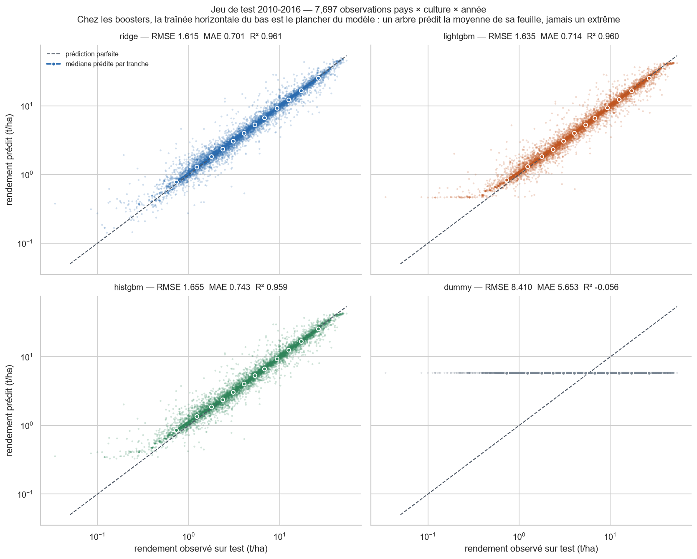
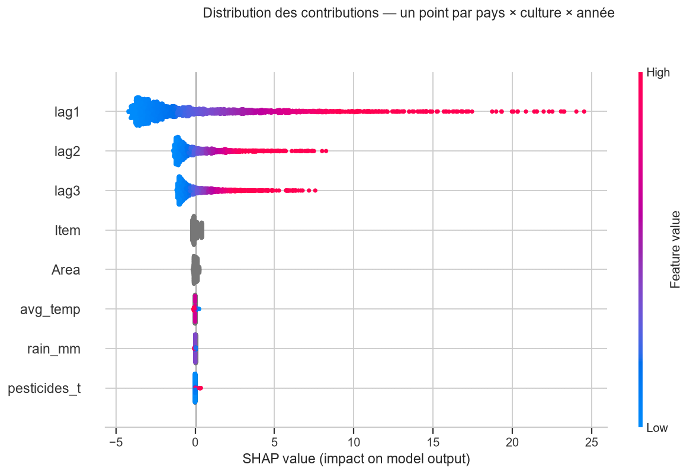
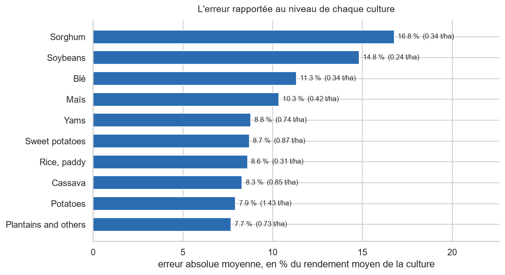

# Étape 2 — Seconde chaîne : prévision nationale sur le panel FAO

*Document de travail destiné à alimenter le rapport métier final. Rédigé pour un lecteur non technique. Il rend compte d'une seconde chaîne de modélisation, construite sur des données réelles, et de ce qu'elle change aux deux fonctions demandées.*

---

## 1. Les données utilisées

La première chaîne de modélisation repose sur un million de parcelles **simulées**. Sa limite était connue et portée au rapport : les effets qu'elle chiffre ne sont pas transposables à une parcelle réelle. Une seconde chaîne a donc été construite sur des données **observées**, publiées par la FAO.

Les deux jeux ne sont pas joignables et **ne partagent aucune colonne**. Ils cohabitent dans le dépôt, pas dans le même espace de variables : chacun a ses chemins, ses variables, sa cible et son découpage. Le code n'en sait rien — un seul paramètre, `--source`, désigne la chaîne à entraîner.

| Caractéristique | Valeur |
|---|---|
| Source | Panel FAO : production, surfaces, climat, pesticides |
| Unité d'observation | **un triplet pays × culture × année** — jamais une parcelle |
| Couverture brute | 212 pays, 10 cultures, 1961 à 2016, soit 56 709 lignes |
| Lignes modélisables | **53 044** après construction des retards |
| Cible | Rendement en tonnes par hectare |
| Rendement moyen | 5,83 t/ha à l'entraînement, médiane 3,50 t/ha |

Les dix cultures sont le manioc, le maïs, le plantain, la pomme de terre, le riz, le sorgho, le soja, la patate douce, le blé et l'igname.

**Ce changement d'unité d'observation est le fait le plus important du document**, et il commande tout ce qui suit. Une ligne ne décrit plus un champ mais la moyenne d'un pays sur une année entière. La température est une moyenne annuelle nationale ; le tonnage de pesticides est un tonnage national, tous usages confondus. Ces grandeurs n'ont pas de dose-réponse à l'échelle d'une parcelle, et les présenter comme des conditions de parcelle serait un contresens.

La couverture des trois covariables est partielle : 56,7 % pour la température, 46,8 % pour la pluviométrie, 44,5 % pour les pesticides. Les exiger toutes trois coûterait 76 % des lignes.

---

## 2. La préparation des variables

Le panel brut ne contient aucune variable explicative utilisable : il donne un rendement, un pays, une culture et une année. Tout le travail consiste à en dériver des variables **connues avant la récolte**.

| Variable | Origine | Rôle |
|---|---|---|
| `lag1`, `lag2`, `lag3` | Dérivées | Le rendement de la même série un, deux et trois ans plus tôt |
| `Area`, `Item` | Clés promues | L'identité de la série : le pays et la culture |
| `avg_temp`, `rain_mm`, `pesticides_t` | Panel FAO | Les trois covariables, conservées telles quelles |

Trois décisions méritent d'être explicitées, parce qu'elles écartent chacune une variable disponible.

**Les retards refusent de franchir un trou.** Une série nationale peut être interrompue — un pays qui cesse de déclarer, puis reprend. Un décalage naïf renverrait alors une valeur vieille de plusieurs années en la présentant comme celle de l'an dernier. Un retard n'est donc accepté que si l'écart d'années vaut exactement ce qu'il prétend valoir. Ce garde-fou, et les trois premières années de chaque série, expliquent les 3 665 lignes écartées.

**La variable `choc` a été construite puis écartée.** Elle mesure l'écart d'une culture à la variation moyenne des autres cultures du pays la même année — un indicateur d'accident climatique. Mais elle exige les rendements de l'année **courante** des autres cultures, inconnus avant la récolte. Un modèle qui s'en sert ne prévoit rien. La distinction est portée par le nom des constantes du code pour qu'aucune étape ne puisse les confondre par inadvertance.

**L'année elle-même n'est pas une variable.** Le découpage étant chronologique, la validation et le test portent sur des années qu'aucun modèle n'a vues. Un arbre les plafonnerait à 2002 — un biais systématique vers le bas, puisque les rendements croissent — et une régression extrapolerait une tendance linéaire sur quatorze ans sans aucun garde-fou. La tendance est portée par les retards : c'est leur rôle.

**Le découpage est chronologique, et ce n'est pas un détail de méthode.** Le tirage aléatoire employé sur les parcelles simulées placerait ici une année adjacente dans l'entraînement pour 95 % des lignes de test : le modèle verrait 2011 et 2013 avant d'être interrogé sur 2012. Mesuré, ce découpage sous-estime l'erreur de 25 %. Les bornes retenues — entraînement jusqu'en 2002, validation de 2003 à 2009, test de 2010 à 2016 — donnent 71,1 / 14,4 / 14,5 % des lignes et interdisent cette facilité.

---

## 3. L'entraînement et le modèle retenu

Quatre modèles ont été entraînés sur la première partition, puis départagés sur la deuxième. La démarche est identique à celle de la première chaîne : recherche automatique d'hyperparamètres par Optuna, 100 essais par modèle, graines fixées, et **305 expérimentations enregistrées** — quatre études et leurs 301 essais — dans un registre MLflow distinct de celui de la chaîne simulée.

| Modèle | RMSE validation | MAE validation | Variation expliquée |
|---|---|---|---|
| Référence naïve — prédit toujours la moyenne | 7,840 t/ha | 5,365 t/ha | nulle |
| **Régression linéaire régularisée** | **1,3796 t/ha** | **0,6430 t/ha** | **96,8 %** |
| Forêt d'arbres (LightGBM) | 1,4103 t/ha | 0,6506 t/ha | 96,7 % |
| Forêt d'arbres (HistGBM) | 1,4183 t/ha | 0,6633 t/ha | 96,6 % |

C'est à nouveau le modèle le plus simple qui gagne, mais **son avance est cette fois réelle** : le test apparié donne z = 2,70 contre LightGBM, au-delà du seuil de 2 retenu pour conclure. Sur les parcelles simulées, les trois modèles étaient indiscernables.

La régression remporte les sept critères mesurés : la plus faible erreur, un écart statistiquement établi, la latence la plus courte — 2,35 ms contre 5,42 et 11,73 — et un artefact de **8,3 Ko contre 10,2 Mo** pour HistGBM, un facteur 1 260 qui compte pour un service appelé en ligne.

**Ce que fait le modèle retenu, en une phrase : une moyenne pondérée des trois dernières années.** Il attribue 0,60 à l'an dernier, 0,20 à l'avant-dernier et 0,17 à celui d'avant, pour une somme de 0,97. Il lisse le passé récent et en suit la pente ; il ne devine pas une rupture que l'historique n'annonce pas. C'est à porter au rapport tel quel, parce qu'une variation expliquée de 96,8 % lue seule laisserait croire l'inverse.

Sur le jeu de test, ouvert une seule fois après que le choix a été arrêté, l'ordre des modèles est préservé : 1,6155 t/ha pour la régression, 1,635 pour LightGBM, 1,655 pour HistGBM. L'erreur absolue passe de 0,643 à 0,701 t/ha, soit de 8,9 % à 9,0 % du rendement moyen : **la dégradation est un décalage de niveau, pas une perte de justesse.**

*Un panneau par modèle, axes partagés et logarithmiques ; la ligne pointillée est la prédiction parfaite, la courbe pleine la médiane des prédictions par tranche de rendement observé. Chez les deux forêts d'arbres, une traînée horizontale apparaît vers 0,3 à 0,5 t/ha : c'est le plancher du modèle.*

Ce plancher a une cause structurelle, et elle explique pourquoi les arbres perdent. Un arbre prédit la **moyenne** des cibles de sa feuille, et une moyenne n'atteint jamais les extrêmes de ce qu'elle agrège : son étendue de sortie est strictement intérieure à celle de la cible, en bas comme en haut. Mesuré, l'arbre plafonne à 42,9 t/ha quand l'observé monte à 54,0.

L'avance de la régression n'est pourtant **pas uniforme**, et c'est le résultat le plus instructif de la comparaison. **Dans** le domaine historique de chaque série, LightGBM la devance — 1,407 contre 1,417. Elle ne gagne que **hors** de ce domaine, sur les 40 % de lignes qui dépassent le maximum de leur propre série, c'est-à-dire précisément celles que produit un découpage chronologique. Changer de forêt d'arbres n'y changerait rien : la compression d'étendue est intrinsèque à la famille.

---

## 4. Trois variables sur huit portent tout le signal

L'analyse d'interprétabilité a été conduite par trois méthodes qui ne mesurent pas la même chose — les coefficients, l'importance par permutation, et la décomposition SHAP. Les 222 colonnes issues de l'encodage du pays et de la culture ont été **regroupées vers leurs huit variables d'origine** avant toute lecture : une contribution attribuée à « France » prise isolément ne voudrait rien dire.

Les trois méthodes donnent le même ordre, et c'est ce qui rend la conclusion solide — elle ne tient pas à un choix de méthode.

| Bloc de variables | Part de la décomposition |
|---|---|
| Les trois retards | **95,2 %** |
| L'identité — pays et culture | 3,8 % |
| Les trois conditions — température, pluviométrie, pesticides | **1,1 %** |

*Là où le rendement de l'an dernier s'étale sur plus de vingt tonnes, les trois conditions forment une barre verticale collée à zéro.*

L'ablation confirme par le calcul : retirer les trois retards coûte 3,8 fois l'erreur, tandis que retirer les cinq autres variables **améliore** le modèle d'un millième. « Tout le dataset » a été mesuré, et il est très légèrement moins bon que les trois retards seuls.

> **Conséquence directe pour l'application.** Demander à l'utilisateur sa température et son usage de pesticides, puis les passer à ce modèle, produirait une interface qui *semble* répondre aux conditions sans le faire : la prédiction bougerait d'un centième de tonne. Ce modèle prévoit la suite d'une série nationale ; il ne simule pas l'effet d'une pratique agricole. C'est une limite de ce que le panel contient, pas un défaut de réglage.

---

## 5. V1 prédiction de parcelle, V2 classement national

Les deux chaînes ne se remplacent pas. Elles répondent à deux questions statistiques différentes, et chacune couvre une des deux fonctions demandées — jamais les deux.

| | V1 — parcelles simulées | V2 — panel FAO |
|---|---|---|
| Unité d'observation | une parcelle | un pays, une culture, une année |
| Lignes | 999 769 | 53 044 |
| Découpage | aléatoire stratifié | **chronologique** |
| Rendement moyen | 4,65 t/ha | 7,77 t/ha sur le test |
| Erreur quadratique sur le test | 0,5013 t/ha | 1,6155 t/ha |
| Erreur absolue sur le test | 0,3998 t/ha | 0,7010 t/ha |
| Variation expliquée | 91,2 % | 96,1 % |
| **Erreur absolue rapportée au rendement moyen** | **8,6 %** | **9,0 %** |

**Les deux lignes d'erreur brute ne sont pas comparables**, et il faut le dire avant d'en tirer quoi que ce soit. Les deux modèles ne prédisent pas le même objet : la dispersion de la cible est quatre fois plus grande sur le panel, et la référence naïve y fait 8,41 t/ha contre 1,70 sur les parcelles. Un chiffre d'erreur trois fois plus élevé sur une cible quatre fois plus dispersée n'indique pas un modèle moins bon.

Seule la dernière ligne se compare : rapportée au rendement moyen, l'erreur est du **même ordre sur les deux chaînes**, environ 9 %. Ce n'est pas une équivalence des deux modèles — c'est le seul indicateur commun disponible, et il ne dit rien de leur valeur d'usage, qui diverge complètement.

### La fonction de prédiction appartient à V1

Le cahier des charges demande qu'un utilisateur sélectionne une culture, renseigne les conditions de sa parcelle et obtienne un rendement estimé. **V1 répond littéralement à ce contrat.** V2 ne peut pas y répondre, et cela a été mesuré plutôt que supposé.

Entraîné sur les seules entrées du contrat — la culture et les conditions, sans aucun historique — et avec ses hyperparamètres réglés pour ce jeu réduit, le modèle linéaire atteint une erreur de 4,85 t/ha et une variation expliquée de 60,5 %. C'est **46 % du chemin** entre la référence naïve et le modèle complet. Une forêt d'arbres fait mieux : 3,66 t/ha et 77,5 %.

Mais ce dernier chiffre ne tient pas à ce qu'il paraît. Ce modèle est corrélé à **0,9375** avec la simple moyenne historique du couple pays-culture, et cette moyenne employée telle quelle atteint 77,6 % à elle seule. Il n'a pas appris un effet des conditions : il a mémorisé le niveau de chaque pays et de chaque culture. C'est un regroupement par moyenne déguisé en modèle.

Deux lectures des conditions doivent donc être tenues ensemble, sans les confondre. Dans le **modèle retenu**, qui dispose des retards, les conditions ne déplacent la prédiction que d'un centième de tonne. Dans le modèle **privé de retards**, elles la déplacent d'environ 3 t/ha — mais sur une cible moyenne de 4,71 t/ha, et en lisant une moyenne nationale annuelle comme si elle décrivait un champ. Ce second chiffre n'est pas un effet agronomique : c'est le modèle qui se raccroche à la seule information d'identité qui lui reste.

### La fonction de recommandation appartient à V2

La première chaîne avait tranché par la négative, et pour une raison structurelle : son modèle étant strictement additif, la contribution de la culture est une constante qui ne dépend pas du contexte. L'écart entre la meilleure et la pire culture y vaut **0,0065 t/ha** et le classement est le même sur 100 % des parcelles. Un conseil qui ne dépend pas de la situation de l'agriculteur n'est pas un conseil.

Sur le panel, le classement existe. Le contrefactuel n'est pas le même et il faut le dire : on ne peut pas recopier une ligne en changeant seulement la culture, puisque les retards sont propres au couple pays-culture. Chaque culture candidate reçoit donc **son** historique national — exactement ce dont une application disposerait, puisque l'utilisateur choisit son pays et ne saisit aucun passé. Les cultures jamais cultivées dans le pays sont écartées : sans ce garde-fou, interrogé sur la France, le modèle place le plantain en deuxième position.

| Mesure | V1 | V2 |
|---|---|---|
| Écart entre meilleure et pire culture | 0,0065 t/ha | **15,35 t/ha** |
| Le classement dépend-il des conditions saisies ? | non, jamais | non |
| Part des pays dont la culture de tête ne change jamais | 100 % | **83,8 %** |

**L'écart est considérable, mais il est presque entièrement dû au niveau de la culture** : une pomme de terre rend dix fois plus qu'un soja, et aucun agriculteur n'a besoin d'un modèle pour l'apprendre. En tonnage, le conseil est d'ailleurs trivial — la pomme de terre arrive en tête dans 55,9 % des situations.

Ce qu'on peut donc annoncer sans mentir : « dans votre pays, ces cultures ont historiquement les meilleurs rendements, et voici leur trajectoire ». Ce qu'on ne peut pas annoncer : « compte tenu de vos conditions, plantez ceci ». La première phrase est utile. La seconde serait une promesse que ces données ne tiennent pas.

**Il manque six prix sur dix** pour que ce classement devienne économique, et c'est bien un classement économique que demande le mot « rentable ». Sur les quatre cultures déjà tarifées, l'ordre change pourtant entre les tonnes et la valeur : le soja passe devant le blé. La démonstration est faite que l'axe économique est décisif ; elle n'est pas encore complète.

---

## 6. Limites à porter au rapport final

**La portée est nationale, pas parcellaire.** La prédiction répond à « ce pays, cette culture, l'an prochain ». C'est la limite dont découlent toutes les autres, et la raison pour laquelle cette chaîne ne remplace pas la première.

**Le panel s'arrête en 2016.** Les retards disponibles sont ceux de 2014 à 2016 : le modèle prédit 2017, pas l'année en cours. Une application qui l'interroge doit afficher cette année de référence, sous peine de présenter une prévision de 2017 comme une prévision d'aujourd'hui.

**L'erreur n'est pas homogène, et de loin.** Elle va de 7,7 % pour le plantain à 16,8 % pour le sorgho selon la culture, et de 1,6 % à 54,0 % selon le pays. L'écart-type du résidu va de 0,24 à 2,95 t/ha du premier au dernier décile de rendement — un facteur 12. **Un intervalle de prédiction unique, comme celui de la chaîne simulée, serait ici faux** : il devrait être calibré par niveau.

*L'erreur relative varie du simple au double selon la culture. Une application qui afficherait une marge d'incertitude unique se tromperait sur la moitié des cultures.*

**Le modèle reconduit le passé récent.** C'est sa force sur une série nationale et sa faiblesse devant un accident : sur sa plus grande erreur, il reconduit la trajectoire et manque un quasi-doublement du rendement, sans qu'aucune variable de condition ne l'ait alerté — parce qu'aucune ne porte cette information.

**Les effets chiffrés par la première chaîne restent non transposables.** Les 300 €/ha de la fertilisation et les 240 €/ha de l'irrigation sont des contributions prédictives estimées sur des données simulées. Cette seconde chaîne ne les valide pas : elle ne contient aucune variable de pratique agricole à l'échelle où ces effets se jouent.
