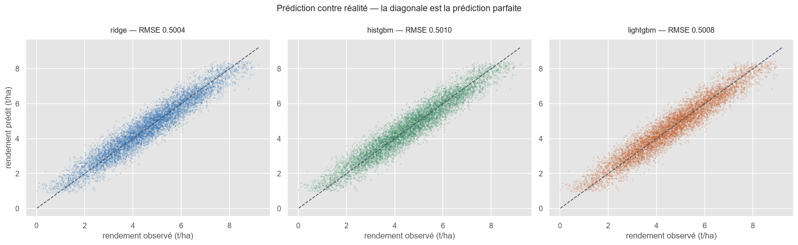
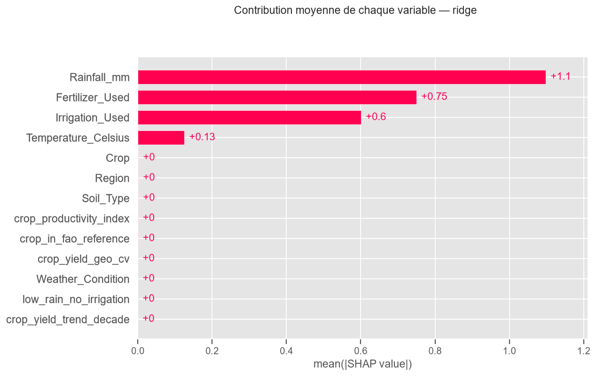
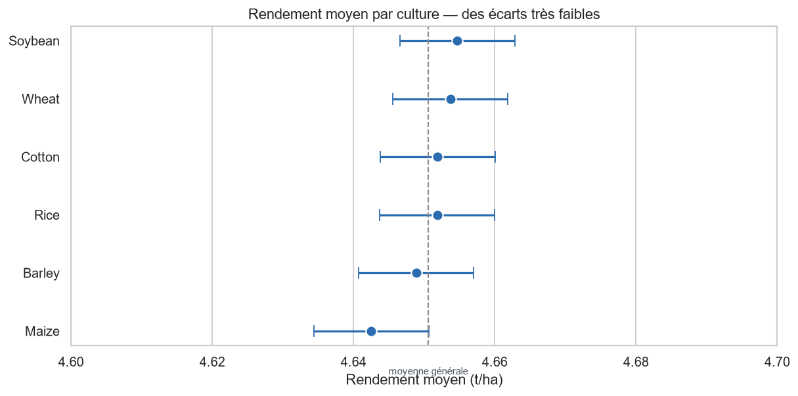
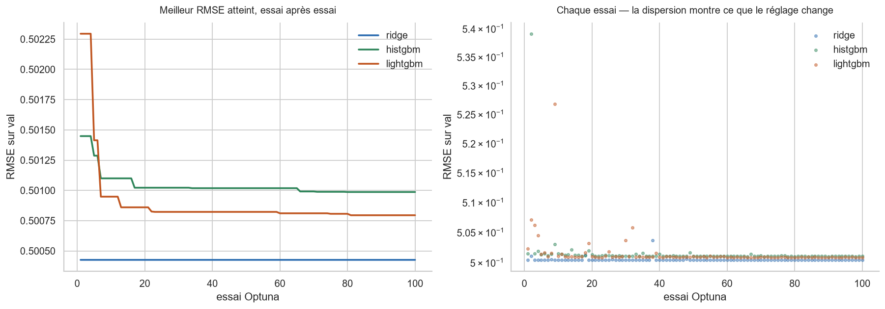

# Étape 2 — Modélisation : performance obtenue et leviers identifiés

*Document de travail destiné à alimenter le rapport métier final. Rédigé pour un lecteur non technique.*

---

## 1. Ce qui a été construit

Quatre modèles ont été entraînés sur **999 769 parcelles**, puis départagés sur un jeu de validation qu'aucun d'eux n'avait vu pendant son apprentissage.

| Modèle | Rôle | Erreur moyenne |
|---|---|---|
| **Référence naïve** | Prédit toujours le rendement moyen — sert d'étalon | 1,699 t/ha |
| **Régression linéaire régularisée** | Modèle simple, effets additifs | **0,500 t/ha** |
| **Forêt d'arbres (LightGBM)** | Modèle complexe, effets non linéaires | 0,501 t/ha |
| **Forêt d'arbres (HistGBM)** | Variante du précédent | 0,501 t/ha |

Le modèle naïve n'est pas là pour concourir : il fixe le seuil en dessous duquel un modèle ne sert à rien. Les trois autres le divisent par **3,4**.

**C'est le modèle le plus simple qui gagne.** Les deux modèles complexes, capables de capter des interactions subtiles, n'en trouvent aucune : ils finissent très légèrement derrière une simple addition d'effets. C'est un résultat en soi — il dit que le rendement, dans ces données, se décompose en contributions indépendantes, sans effet de seuil ni de combinaison.

---

## 2. Ce que vaut le modèle retenu

La performance annoncée est mesurée sur un troisième jeu de données, **ouvert une seule fois, après que le choix du modèle a été arrêté**. C'est ce qui rend le chiffre crédible : aucune décision n'a été prise en le regardant.

| Indicateur | Valeur | Lecture métier |
|---|---|---|
| Variation du rendement expliquée | **91,2 %** | Le modèle capte l'essentiel de ce qui fait varier un rendement |
| Erreur moyenne | **0,40 t/ha** | Soit **8,6 %** du rendement moyen (4,65 t/ha) |
| Erreur en valeur | **80 €/ha** | À 200 €/tonne |
| Écart validation → test | **+0,0008 t/ha** | Le modèle ne s'est pas sur-ajusté : il tient hors de ses données d'entraînement |

*Chaque point est une parcelle. Plus le nuage est serré autour de la diagonale, plus le modèle est juste. L'alignement est net sur toute la plage de rendement, sans zone où le modèle décrocherait.*

Le dernier indicateur est le plus important pour la confiance : un modèle qui excelle sur ses données d'apprentissage et s'effondre sur des données nouvelles est inutilisable. Ici l'écart est de huit dix-millièmes de tonne — **la performance mesurée est celle qu'on obtiendra en production**, sous réserve que les parcelles traitées ressemblent à celles des données.

---

## 3. Les leviers du rendement, chiffrés

C'est le résultat directement actionnable. Quatre facteurs déterminent le rendement, et **leurs effets se lisent en euros par hectare**.

| Levier | Effet sur le rendement | Produit brut à 200 €/t |
|---|---|---|
| **Fertiliser** | +1,50 t/ha | **+300 €/ha** |
| **Irriguer** | +1,20 t/ha | **+240 €/ha** |
| **Pluviométrie** | +0,005 t/ha par mm | +1 €/ha par mm |
| **Température** | +0,020 t/ha par °C | +4 €/ha par °C |

*Contribution moyenne de chaque variable à la prédiction. Les quatre premières portent la totalité du signal ; les neuf autres sont indiscernables de zéro.*

Deux lectures s'imposent :

**La pluviométrie est le premier facteur, et de loin.** Son effet unitaire paraît faible — 1 €/ha par millimètre — mais elle varie de 100 à 1 000 mm dans les données. D'un extrême à l'autre, cela représente **4,5 t/ha, soit 900 €/ha**. C'est le facteur dominant, et c'est aussi le seul sur lequel l'agriculteur n'a aucune prise : d'où l'importance des deux suivants.

**Fertilisation et irrigation sont les deux seuls leviers pilotables**, et ils sont du même ordre de grandeur : 300 et 240 €/ha de produit brut. Ce sont des décisions binaires — on fertilise ou non, on irrigue ou non — ce qui les rend directement traduisibles en conseil.

> **Réserve essentielle.** Ces montants sont du **produit brut**, pas du bénéfice. Fertiliser et irriguer coûtent, et **aucune donnée de coût n'a été fournie**. L'arbitrage « est-ce rentable ? » suppose de connaître le prix des intrants et de l'eau. Le modèle dit ce que rapporte l'action ; il ne dit pas ce qu'elle coûte.

---

## 4. La recommandation de culture : la question est tranchée

L'étape 1 avait laissé deux voies ouvertes — injecter une référence externe pour différencier les cultures, ou renoncer au classement. **L'étape 2 tranche pour le renoncement, et le démontre.**

À conditions de parcelle rigoureusement identiques, nous avons demandé au modèle de simuler les six cultures et mesuré l'écart entre la meilleure et la pire :

| Mesure | Valeur |
|---|---|
| Écart de rendement entre meilleure et pire culture | **0,0065 t/ha** |
| Soit, en valeur | **1,29 €/ha** |
| À comparer à l'erreur du modèle | **80 €/ha** |
| Rapport | **1 pour 62** |

*Attention à l'échelle : elle couvre un dixième de tonne par hectare. Les six cultures y tiennent toutes, et leurs marges d'incertitude se recouvrent.*

Le gain théorique d'un changement de culture est **62 fois plus petit que l'incertitude du conseil lui-même**. Autrement dit, la recommandation serait noyée dans sa propre marge d'erreur.

Un second constat achève la démonstration : **le classement est constant**. L'orge arrive en tête sur 100 % des parcelles, quelles que soient les conditions. Un conseil qui ne dépend pas de la situation de l'agriculteur n'est pas un conseil.

Enfin, nous avons vérifié que retirer purement et simplement l'information « culture » du modèle — la variété elle-même et les quatre indicateurs de référence construits à l'étape 1 — **ne dégrade rien**. Elle n'apporte aucune information exploitable.

**Conséquence pour l'application** : elle sera présentée comme un **estimateur de rendement**, pas comme un conseiller de culture. Et le message métier n'est pas un aveu d'échec — c'est une réorientation : *le levier n'est pas le choix de la culture, il est dans la fertilisation et l'irrigation, dans un rapport de 1 à 232*.

---

## 5. La démarche d'optimisation

Chaque modèle a été réglé automatiquement par une recherche d'hyperparamètres — l'équivalent du réglage fin d'un instrument. **305 expérimentations** ont été enregistrées et horodatées dans MLflow, le journal de bord du projet.

| Élément | Détail |
|---|---|
| Méthode de recherche | Optuna, échantillonneur TPE — apprend des essais passés plutôt que de balayer une grille |
| Essais par modèle | 100 |
| Métriques suivies | Erreur (RMSE, MAE), variation expliquée (R²), et trois indicateurs économiques |
| Traçabilité | Chaque essai porte l'empreinte du jeu de données, du découpage et des hypothèses de prix |

*À gauche, la meilleure erreur atteinte au fil des essais : les courbes s'aplatissent bien avant le centième, le budget de recherche était suffisant. À droite, la dispersion des essais montre ce que le réglage change réellement.*

La reproductibilité est assurée par des graines aléatoires fixées à chaque étape — découpage des données, échantillonnage des hyperparamètres, entraînement. **Relancer la chaîne redonne exactement les mêmes résultats.**

---

## 6. Limites à porter au rapport final

**Les données sont simulées.** Le modèle retrouve presque exactement la formule qui a servi à les générer : 0,005 par millimètre de pluie, 0,020 par degré, 1,50 pour la fertilisation, 1,20 pour l'irrigation. Une telle régularité ne s'observe jamais sur des parcelles réelles. Le prototype démontre la chaîne complète, de la donnée à l'application — mais **les effets chiffrés ne sont pas des résultats agronomiques transposables**.

**Le plafond de performance est atteint.** Les données contiennent une part d'aléa irréductible, que nous avons mesurée à 0,500 t/ha. Le modèle atteint 0,5013 : il en est à **treize dix-millièmes**. Aucun modèle plus sophistiqué ne fera mieux — la marge restante n'est pas de l'information non exploitée, c'est du bruit.

**Produit brut, pas bénéfice.** Déjà signalé à l'étape 1 et toujours valable : sans données de coût, l'application peut dire ce que rapporte une pratique, pas si elle est rentable. Obtenir ne serait-ce qu'un ordre de grandeur du prix des intrants changerait la valeur du produit.

**Le modèle n'est pas encore déployable tel quel.** Il attend 13 variables, alors que l'agriculteur n'en saisira que 8 : les 5 autres sont calculées à partir des premières. Tant qu'un module de préparation ne les reconstruit pas automatiquement, l'application ne peut pas interroger le modèle avec les seules saisies de l'utilisateur. **C'est le premier chantier de l'étape suivante.**

**La prédiction suppose des conditions connues.** Les variables climatiques décrivent une saison **observée**. L'application est un simulateur « si les conditions sont celles-ci, voici le rendement attendu » — elle ne prévoit pas la météo, et ne donne donc pas une prévision avant semis.

---

## 7. Ce qui a été livré

| Livrable | Contenu |
|---|---|
| **Modèle final** | `modele_final.joblib` — 5 Ko, réponse en 3 ms, rechargement vérifié |
| Pipeline d'entraînement | `scripts/train.py` et le module `agritech` — préparation, optimisation, évaluation |
| Notebook de comparaison | Évaluation des quatre modèles, analyse des variables, décision argumentée |
| Journal des expérimentations | 305 runs MLflow, métriques et paramètres complets |
| Figures | Performance, leviers, optimisation, analyse par culture |

Le modèle retenu est **la régression linéaire régularisée**, choisie sur cinq critères qu'elle remporte — meilleure erreur, écart statistiquement établi avec le suivant, temps de réponse le plus court, fichier le plus léger, coefficients directement lisibles — le sixième, la régularité du comportement d'une culture à l'autre, ne départageant aucun des trois modèles.

Son avance sur le meilleur modèle complexe est pourtant **pratiquement nulle** — quelques centièmes d'euro par hectare. Ce n'est pas sa performance qui le désigne, c'est qu'il ne perd sur aucun autre critère, tout en étant le seul dont on puisse expliquer chaque prédiction sans outil d'interprétation.
