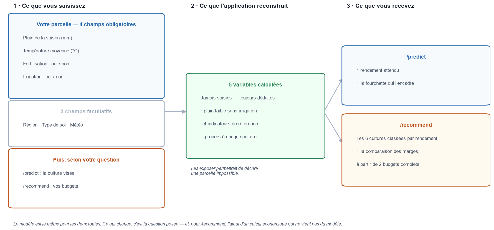
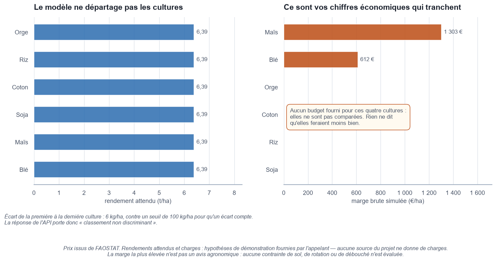
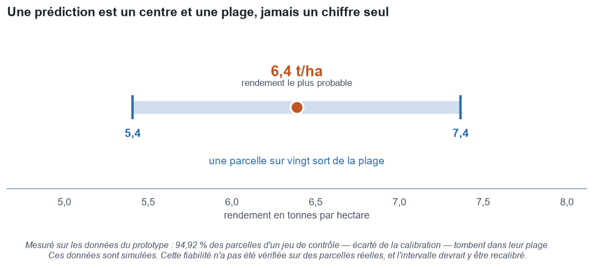
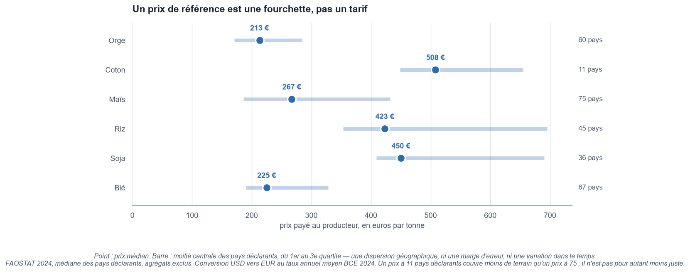

# Étape 3 — L'API de prédiction : contrat de service, sourçage et traçabilité

*Document de travail destiné à alimenter le rapport métier final.*

*Les sections 1 à 7 — ce que l'application demande, ce qu'elle répond, et ce qu'elle refuse d'affirmer — se lisent sans connaissance technique : c'est la partie qui concerne l'agriculteur. Les sections 8 à 11 portent sur le déploiement et la traçabilité, et s'adressent à qui reprendra le service.*

---

## 1. Le chantier que cette étape devait ouvrir

L'étape 2 s'était arrêtée sur un constat précis : *« Le modèle n'est pas encore déployable tel quel. Il attend 13 variables, alors que l'agriculteur n'en saisira que 8. »*

C'est le premier verrou que cette étape lève. Le second est de nature différente : un modèle qui prédit n'est pas encore un service. Il lui manque un contrat — ce qu'on peut lui demander, ce qu'il répond, et **ce qu'il refuse d'affirmer**.

| Livrable | Contenu |
|---|---|
| **Transformateur de dérivation** | `src/agritech/preprocessing.py` — reconstruit les 5 variables calculées à partir des 8 saisies |
| **Artefact de service** | `models/modele_api.joblib` et son fichier de provenance `modele_api.json` |
| **API** | `api/` — 6 routes FastAPI, contrat Pydantic, journal des appels |
| **Image Docker** | `agritech-api` — 666 Mo, autonome, sans MLflow ni base de données |
| **Outillage** | Export et promotion du modèle, re-dérivation des prix, test de fumée du conteneur, génération des figures de ce rapport |
| **Tests** | **100 tests automatisés**, 11 secondes — et 96 % du code servi couvert, branches comprises |

---

## 2. Le pont entre ce que l'agriculteur sait et ce que le modèle attend

Cinq des treize variables du modèle ne sont pas des saisies : elles se **calculent** à partir des autres. Quatre sont des indicateurs de référence déterminés par la seule culture ; la cinquième croise la pluviométrie et l'irrigation.

Le choix fait ici est de ne **jamais** les exposer à l'utilisateur. La raison n'est pas théorique : l'étape 2 a produit exactement le bug correspondant en changeant la culture sans mettre à jour les indicateurs associés, ce qui faussait de 24 % la mesure centrale de la recommandation. Laisser ces champs ouverts permettrait de déclarer une parcelle impossible — 800 mm de pluie, irriguée, et pourtant en situation de faible pluie sans irrigation.

La dérivation est donc un **transformateur ajusté sur les données d'entraînement**, greffé devant le modèle et gelé avec lui dans le même fichier. L'API ne réimplémente aucune règle : celle qui sert en production est, par construction, celle qui a servi à l'apprentissage. Les deux ne peuvent pas diverger.

> **Un détail qui ne se voit que dans le conteneur.** La table de correspondance mémorisée par ce transformateur a dû être forcée en type Python natif. Sans cela, la bibliothèque de données l'adosse à un format binaire tiers dès qu'il est installé sur le poste, et le fichier exporté en garde la référence : il exigerait à la relecture un paquet que l'image de l'API n'installe pas. Le défaut est invisible en développement, et fatal au déploiement.

---

*Les cinq variables du bloc central ne sont jamais saisies : l'application les reconstruit. C'est ce qui permet d'interroger avec huit informations connues d'un agriculteur un modèle qui en attend treize.*

---

## 3. Le contrat des six routes

| Route | Méthode | Ce qu'elle rend | Dépend du modèle |
|---|---|---|---|
| `/predict` | POST | Le rendement d'une culture, avec son intervalle à 95 % | oui |
| `/recommend` | POST | Les six cultures classées, et la comparaison économique | oui |
| `/reference/prices` | GET | Les six prix à la production sourcés, avec leur dispersion | **non** |
| `/model/info` | GET | Provenance du modèle servi et valeurs acceptées | oui |
| `/health` | GET | Le service répond et son modèle est chargé | oui |
| `/logs` | GET | Les derniers appels observés, succès **et** rejets | non |

### 3.1 `/predict` — une culture, un contexte

Cinq champs obligatoires — pluviométrie, température, fertilisation, irrigation, culture — et trois facultatifs : région, type de sol, météo. Les trois facultatifs peuvent être omis ; le modèle traite alors l'information comme absente, et la réponse le signale.

Cette omission a été **mesurée, pas supposée** : sur 5 000 parcelles, les trois champs absents déplacent la prédiction de 0,0017 t/ha en moyenne, soit 0,34 % de l'erreur du modèle. Le biais moyen est indiscernable de zéro.

En revanche, une valeur *invalide* est refusée, jamais traitée comme une omission. Sans ce garde-fou, une faute de frappe deviendrait un champ vide sans que personne ne s'en aperçoive.

La réponse ne contient **aucune traduction monétaire**. Un prix unique appliqué à six cultures n'aurait pas de sens agronomique ; la valorisation est le travail de `/recommend`, et seulement à partir des budgets de l'appelant.

### 3.2 `/recommend` — le classement, et ce qu'il vaut

Deux classements, de statut très différent.

**Le classement par rendement est toujours rendu**, accompagné d'une note qui en donne la portée. Sur ces données, l'écart entre la première et la dernière culture est de l'ordre de 6 kg/ha, à comparer au seuil de pertinence pratique retenu pour le projet : **0,1 t/ha, soit 100 kg/ha**. La note le dit sans détour : *ce classement est exact mais sans pouvoir discriminant*.

Ce seuil est une **convention métier annoncée**, pas un seuil de significativité statistique. Il correspond à l'ordre de grandeur de ce qu'une pesée de récolte réelle distingue, une fois comptées l'humidité, les pertes au battage et l'hétérogénéité de la parcelle ; valorisé aux prix observés, il représente 21 à 51 €/ha, soit moins que la précision de n'importe quel budget prévisionnel.

> **Ce que ce seuil ne dit pas.** Que deux cultures séparées par moins de 100 kg/ha seraient « statistiquement indiscernables ». La significativité des écarts entre cultures **n'a pas été évaluée formellement** dans ce projet, et ce seuil n'en tient pas lieu : il borne la portée *pratique* d'un écart, pas sa détectabilité. C'est aussi pourquoi la note ne compare jamais l'écart à l'intervalle de prédiction — l'incertitude d'une prédiction individuelle n'est pas celle d'une différence entre deux prédictions, et les rapprocher suggérerait une égalité que rien n'établit.

**Le classement économique n'apparaît qu'à partir de deux budgets complets.** En dessous, aucune marge n'est comparable : le bloc reste absent plutôt que trompeur, et l'avis rendu porte le statut `undetermined` avec le motif de l'abstention.

Chaque classement économique est soumis à un **test de sensibilité au prix** : tous les prix varient simultanément de ±20 %, rendements et charges constants. Le test n'est pas tautologique — les charges ne suivant pas le facteur, l'ordre peut se renverser dès que les recettes diffèrent d'une culture à l'autre. Une paire que les trois scénarios ne départagent pas est signalée comme indistincte, et l'avis annonce alors **plusieurs cultures plutôt qu'un gagnant inventé**.

*À gauche, les six cultures à conditions de parcelle identiques : six barres indiscernables. À droite, les marges calculées sur deux budgets fournis par l'appelant. Même parcelle, même modèle — c'est l'économie qui départage, pas le rendement. Et les quatre emplacements vides disent ce que l'API refuse de combler.*

### 3.3 `/reference/prices` — la seule route qui ne calcule rien

Elle répond même si l'artefact venait à manquer : ce sont des données externes, pas un résultat d'inférence. Son rôle est d'amorcer le champ *prix* des budgets de `/recommend` plutôt que de laisser l'utilisateur devant une case vide. La section 5 détaille d'où vient chaque chiffre.

### 3.4 `/logs` — les rejets comptent autant que les succès

Les appels refusés y figurent. Un rejet renseigne sur ce que les utilisateurs saisissent mal, ce qu'un journal des seuls succès tairait. C'est la raison pour laquelle l'interception se fait en amont des routes : une requête invalide n'atteint jamais le code métier.

> **Deux limites assumées, répétées dans la réponse elle-même.** Le journal vit dans la mémoire du processus : il disparaît au redémarrage, et chaque worker tient le sien. Et cette route **n'est protégée par rien**, alors qu'elle expose les budgets transmis à `/recommend` — les prix et les charges de ses utilisateurs. Elle ne doit pas être ouverte publiquement en l'état.

---

## 4. L'intervalle de prédiction : le protocole de calibration

C'est le chiffre le plus facile à produire de travers, et le plus difficile à défendre. Le protocole retenu tient en quatre points.

| Étape | Ce qui a été fait |
|---|---|
| **Calibration** | Quantiles empiriques des résidus, calculés sur le jeu de validation |
| **Mesure** | Couverture vérifiée sur le jeu de test, **exclu de la calibration** |
| **Résultat** | Demi-largeur **± 0,979 t/ha** — couverture mesurée **94,92 %** pour 95 % visés |
| **Robustesse** | Tenue par culture (94,73 % à 95,01 %), aux déciles extrêmes de pluie et de température, et sur les parcelles sèches sans intrants (95,27 %) |

*Le point est le rendement le plus probable, la plage celle dans laquelle il devrait tomber. Un chiffre seul se lirait comme une promesse ; c'est la plage qui porte l'information utile — et la note sous la figure dit sur quelles données cette fiabilité a été mesurée.*

**Le deuxième point du tableau est celui qui donne sa valeur au chiffre** : la couverture n'est pas mesurée là où l'intervalle a été calibré. Un intervalle calibré et vérifié sur les mêmes données annoncerait mécaniquement le niveau visé, sans rien prouver.

Une largeur unique suffit parce que la variance des résidus est constante : l'écart-type par décile de prédiction varie de 1,5 %. La borne basse est tronquée à zéro — un rendement ne peut pas être négatif.

**C'est un intervalle de prédiction, pas un intervalle de confiance.** Il encadre le rendement d'*une* parcelle, pas la moyenne d'un ensemble de parcelles. Le second serait beaucoup plus étroit, et répondrait à une autre question que celle de l'agriculteur.

Hors du domaine d'entraînement — 100 à 1 000 mm de pluie, 15 à 40 °C — la réponse porte un avertissement explicite. Le modèle **extrapole linéairement et sans plafond** : rien ne borne la prédiction, et la couverture de l'intervalle n'y a pas été vérifiée. L'API avertit mais ne refuse pas : une saison plus humide que toutes celles observées reste une question légitime.

> **Réserve.** Les données sont simulées avec un bruit gaussien, dont cet intervalle mesure fidèlement la dispersion. Sur des parcelles réelles, il devrait être recalibré — et la normalité parfaite des résidus ne s'y observerait pas.

---

## 5. Les prix de référence : d'où vient chaque chiffre

Aucun des deux jeux de données du projet ne contient de prix. Les six valeurs servies par `/reference/prices` viennent donc de l'extérieur, et leur provenance est rendue avec elles.

**Source** : FAOSTAT — l'organisation statistique de la FAO, agence des Nations unies pour l'alimentation et l'agriculture. Domaine *Producer Prices*, élément 5532 « Producer Price (USD/tonne) », année 2024. Conversion en euros au taux annuel moyen BCE 2024 (1,08238 USD/EUR).

| Culture | Prix médian | Fourchette interquartile | Pays déclarants |
|---|---|---|---|
| Orge | 213 €/t | 171 – 284 | 60 |
| Coton *(graine, non égrené)* | 508 €/t | 449 – 655 | 11 |
| Maïs | 267 €/t | 186 – 432 | 75 |
| Riz | 423 €/t | 353 – 695 | 45 |
| Soja | 450 €/t | 409 – 690 | 36 |
| Blé | 225 €/t | 190 – 328 | 67 |

*La barre couvre la moitié centrale des pays déclarants — une dispersion géographique, pas une marge d'erreur. Le riz s'étale de 353 à 695 €/t : lire « 423 €/t » sans voir cet étalement donnerait au chiffre une précision qu'il n'a pas.*

Quatre décisions méritent d'être explicitées.

**Médiane plutôt que moyenne.** Quelques pays à prix très élevés — souvent de petits marchés insulaires — tireraient une moyenne vers le haut sans rien dire du prix qu'un producteur rencontre.

**Les quartiles sont rendus avec la médiane, délibérément.** Lire 267 €/t pour le maïs sans voir que les pays déclarants s'étalent de 186 à 432 €/t donnerait à ce chiffre une précision qu'il n'a pas. La route porte d'ailleurs sa propre réserve dans le JSON, pour le client qui consomme la donnée sans jamais ouvrir la documentation.

**Le coton retenu est la graine non égrenée**, pas la fibre. C'est ce qui sort de la ferme ; la fibre est un produit industriel vendu près de trois fois plus cher, et n'a rien à faire dans un budget de producteur.

**La qualité des valeurs est rapportée, jamais filtrée.** FAOSTAT marque chaque prix d'un drapeau : officiel, estimé, imputé, repris d'un tiers. Les **294 valeurs retenues portent toutes le drapeau « valeur officielle »** — déclarées par les pays, ni estimées ni imputées. Ce n'est pas acquis pour les années suivantes : le script de re-dérivation le **signale** au lieu d'écarter en silence, car filtrer déplacerait la médiane sans que personne ne l'ait décidé.

### 5.1 Des chiffres re-dérivables, pas des affirmations

Six nombres écrits à la main dans un fichier de configuration sont des affirmations. Le script `scripts/build_reference_prices.py` les rend **re-dérivables**, et peut constater qu'ils n'ont pas dérivé : exécuté en mode vérification, il recalcule tout depuis l'export FAOSTAT et sort en erreur au moindre écart. C'est ce qu'une chaîne d'intégration continue exécuterait.

> **Un piège rencontré en l'écrivant, et encodé dans le script.** Le fichier de codes produits de FAOSTAT orthographie certains produits avec un point-virgule — *« Seed cotton; unginned »* — là où le fichier de données met une virgule. Un filtre construit sur le fichier de codes ne renvoie **aucune ligne, sans lever d'erreur** : le coton disparaîtrait silencieusement du résultat, et les cinq autres cultures ne laisseraient rien soupçonner. Le script refuse désormais de continuer si l'un des six produits ne ramène rien.

---

## 6. Les charges : pourquoi l'API n'en invente aucune

Les prix se sourcent ; **les charges opérationnelles, non**. Aucune base publique ne donne un coût de production par hectare comparable entre pays, et transposer un barème de chambre d'agriculture française à une parcelle de localisation inconnue n'aurait pas de sens.

Cette absence est donc **assumée et portée par le contrat** : les budgets sont fournis par l'appelant, et chaque marge renvoyée est estampillée `"source": "user"`. Les exemples de la documentation — riz, blé — sont annoncés comme illustratifs.

La convention de calcul est une **marge brute simplifiée, hors aides et coproduits** : prix × rendement − charges opérationnelles. C'est l'indicateur de référence des chambres d'agriculture, dans sa forme la plus réduite. Elle ignore les charges de structure, ce qui n'est légitime que si les cultures comparées partagent le même système — vrai ici, puisque fertilisation et irrigation sont fixées pour toute la requête, donc identiques pour les six cultures.

Cette convention porte un identifiant de version, repris dans chaque réponse économique : deux résultats calculés sous des hypothèses différentes ne sont pas comparables, et il faut pouvoir le constater.

**Ce que l'API établit** : *telle culture présente la marge brute simulée la plus élevée parmi celles que vous avez évaluées.*
**Ce qu'elle n'établit pas** : *telle culture est la plus rentable pour votre exploitation.* Une marge sur une campagne n'est pas un conseil d'assolement, qui se raisonne en rotation.

---

## 7. Ce que l'API refuse d'affirmer

C'est la partie du contrat la moins visible et la plus structurante. Quatre refus explicites.

**Aucune culture n'est déclarée agronomiquement favorable.** Les six portent le statut `not_assessed`, avec son motif : le référentiel de faisabilité n'a pas été audité à ce stade. Déclarer « favorable » sans critère réellement évalué serait la seule faute possible ici — et le contrat précise que `not_assessed` ne doit pas se lire comme « favorable ».

**Aucune recommandation ne sort du classement par rendement.** L'étape 2 avait établi deux choses : retirer l'information « culture » du modèle ne dégrade pas la prédiction, et l'écart entre cultures reste très en deçà du seuil de pertinence pratique retenu. L'API ne revient pas sur cette conclusion par une porte dérobée — et elle ne la durcit pas davantage en équivalence statistique, qui n'a pas été évaluée.

**Aucun avis quand les données ne tranchent pas.** Moins de deux budgets, et le statut est `undetermined` avec le motif de l'abstention — et non le classement par rendement en guise de lot de consolation.

**Aucune culture non budgétée n'est implicitement disqualifiée.** Quand le classement économique ne porte que sur une partie des six, la note le dit, nomme celles qui manquent, et ajoute que *rien ne permet d'affirmer qu'elles feraient moins bien*.

Chaque réponse porte enfin un bloc `data_quality` qui rappelle que **les données d'entraînement sont simulées**, nomme la version des données, du découpage et des hypothèses économiques, et liste les avertissements déclenchés.

---

## 8. La traçabilité, du registre d'expériences au conteneur

Le modèle servi n'est pas celui de l'étape 2 : c'est un **artefact de service** construit à partir de lui — le transformateur de dérivation greffé devant, l'ensemble gelé. Le modèle lui-même n'est pas réentraîné.

La chaîne est la suivante, et chaque maillon est vérifié avant le suivant :

1. **Toutes les vérifications de parité passent avant la première écriture.** Un artefact qui ne prédirait pas exactement comme sa source ne doit pas atteindre le disque, et encore moins le registre. C'est le point précis où un projet d'apprentissage automatique se casse sans bruit.
2. **Publier n'est pas déclarer prêt à servir.** La version est publiée *sans alias* ; l'étiquette `champion` ne se pose qu'après les tests d'intégration, par une commande distincte.
3. **L'artefact est scellé par son empreinte SHA-256**, inscrite dans le fichier de provenance et dans le registre. Au démarrage, l'API recalcule cette empreinte et **refuse de servir** si elle ne correspond pas.

Ce sceau est le contrôle qui compte dans un conteneur. Une image fige un modèle et un fichier de provenance au moment de sa construction, et plus rien ensuite ne dit qu'ils vont ensemble : un artefact périmé, resté d'une couche antérieure ou recopié d'une autre image, servirait des prédictions en annonçant une provenance qui n'est pas la sienne. La vérification a lieu **avant** le chargement : désérialiser un fichier dont on sait déjà qu'il ne correspond pas à sa provenance n'apporterait rien et exécuterait son contenu.

> **Ce que l'empreinte n'atteste pas.** Que l'étiquette `champion` du registre désigne encore cette version. Une image est immuable, une étiquette ne l'est pas : elle a pu bouger depuis la construction. `/model/info` annonce donc la version **embarquée**, sans prétendre interroger le registre.

> **La promotion n'est pas atomique, et le script ne le prétend pas.** Elle touche deux systèmes — un fichier et un registre — qu'aucune transaction ne couvre ensemble. La propriété réellement offerte est l'**idempotence** : en cas d'échec partiel, le script le signale sans ambiguïté, et sa réexécution converge vers l'état visé **sans créer de version supplémentaire**. Il conserve par ailleurs la version précédemment étiquetée, pour permettre un retour arrière.

L'API accepte deux sources, et une seule fonction les charge : l'artefact embarqué par défaut — le cas du conteneur — ou le registre MLflow si une variable d'environnement le désigne. Dans ce second cas, un écart entre ce que sert le registre et ce que décrit la provenance **fait échouer le démarrage** : mieux vaut refuser de servir que d'estampiller une prédiction d'une provenance fausse.

Dans tous les cas, le modèle est chargé **une fois au démarrage**, et éprouvé par une prédiction témoin. Un échec se voit alors dans les journaux du déploiement, pas dans la requête d'un utilisateur.

---

## 9. Le conteneur

| Caractéristique | Valeur |
|---|---|
| Taille de l'image | **666 Mo** |
| Démarrage | **moins de 2 s** entre `docker run` et la première réponse de `/health`, sans aucun montage externe |
| Compte d'exécution | utilisateur non privilégié, pas `root` |
| Supervision | contrôle de santé intégré, interrogeant `/health` |
| Dépendances installées | **25 paquets**, verrouillés à la version près |

Le temps de démarrage se mesure entre `docker run` et la première réponse de `/health` : 1,6 à 1,8 seconde sur trois essais consécutifs. Le tout premier démarrage après une reconstruction demande environ 3 secondes, le temps que le système mette les couches de l'image en cache.

L'image est construite en deux temps : les dépendances sont installées dans un premier étage, et seul l'environnement résultant passe dans l'image finale. L'outillage de construction n'y figure pas.

**Le conteneur est autonome.** Il a été vérifié qu'il ne contient ni MLflow, ni la bibliothèque de données binaire, ni aucun des outils d'expérimentation de l'étape 2, et qu'il n'accède à aucune base de données locale. Un service de prédiction qui embarquerait sa plateforme d'expérimentation confondrait deux métiers.

**Les versions ont une source unique.** Le fichier de verrouillage du gestionnaire de paquets fait foi ; l'image l'installe à l'identique, et échoue si ce fichier n'est plus à jour. Le `requirements.txt` exigé par le cahier des charges en est un **export généré**, jamais édité à la main : sa régénération étant déterministe, une dérive se détecte automatiquement.

**Le refus a été éprouvé, pas supposé.** En substituant un faux modèle à l'intérieur du conteneur en cours de démarrage, le service **s'arrête avec un code d'erreur** en nommant les deux empreintes, celle attendue et celle constatée. C'est un test du test de fumée : il vérifie que le garde-fou se déclenche, pas seulement qu'il existe.

---

## 10. Ce qui a été vérifié

**100 tests automatisés**, exécutés en 11 secondes, portant notamment sur :

- la concordance entre les modalités annoncées par le contrat et celles réellement apprises par l'encodeur — une divergence rendrait la documentation mensongère ;
- la parité de prédiction entre l'artefact embarqué et le modèle du registre, culture par culture ;
- le comportement du sceau : artefact absent, empreinte manquante, empreinte fausse, artefact conforme ;
- l'idempotence de la promotion, et son refus en cas de provenance discordante ;
- le refus d'élire un gagnant quand trois cultures affichent la même marge : l'API nomme les trois ;
- le fait que **toutes les routes exposées sont documentées** — un test qui a d'ailleurs échoué à l'ajout de `/reference/prices`, et fait son travail ;
- la cohérence du tri sur les valeurs exactes, non arrondies : trier sur l'affichage créait des ex æquo que l'ordre de déclaration départageait en silence.

### La couverture de code

Mesurée en **couverture de branches** : un test qui traverse une condition sans
jamais emprunter son autre côté ne la compte pas comme couverte. C'est plus
exigeant que de compter les lignes exécutées.

| Module | Son rôle | Couverture |
|---|---|---|
| `api/schemas.py` | le contrat : ce que l'API accepte et renvoie | **100 %** |
| `src/agritech/config.py` | les constantes du projet | **100 %** |
| `api/service.py` | le moteur de calcul | **96 %** |
| `src/agritech/preprocessing.py` | le transformateur embarqué | **92 %** |
| `api/main.py` | les six routes | **90 %** |
| `api/journal.py` | le journal des appels | **88 %** |
| **Ensemble du code servi** | | **96 %** |

Le périmètre mesuré est **le code qui part dans le conteneur**. Les modules
d'entraînement de l'étape 2 en sont exclus : ils s'exécutent lors d'un
apprentissage, pilotés par MLflow et Optuna, et non sous les tests. Les y
mêler donnerait un taux global de 76 % qui ne mesurerait ni le service ni la
chaîne d'entraînement. L'exclusion est écrite et justifiée dans
`pyproject.toml`, où elle est vérifiable.

Les quelques lignes non couvertes sont des **chemins de refus volontairement
inatteignables** : le filet qui rattraperait une divergence entre les
constantes et l'encodeur — qu'un autre test rend impossible — et la branche
« le classement a un pouvoir discriminant », qui ne peut pas se produire avec
ce modèle. Les couvrir reviendrait à tester des messages d'erreur.

Le rapport détaillé se régénère par `uv run pytest --cov --cov-report=html`.

S'y ajoute un **test de fumée du conteneur** de 24 contrôles, organisé en trois familles : autonomie de l'image, bon fonctionnement du service, et déclenchement effectif des refus.

---

## 11. Limites portées à l'étape suivante

**`/logs` n'est protégée par rien** et expose les budgets transmis à `/recommend`. L'ouvrir publiquement reviendrait à publier les données économiques de ses utilisateurs. Une authentification est à prévoir avant toute exposition réelle.

**Le journal n'est pas un journal d'audit.** Il vit dans la mémoire du processus, disparaît au redémarrage, et chaque worker tient le sien. Il sert à observer, pas à prouver.

**Les prix sont des médianes mondiales**, pas des prix français. Leur assise varie beaucoup : 11 pays déclarants pour le coton, 75 pour le maïs. Une version territorialisée serait un progrès net, et changerait la valeur de la comparaison économique.

**Le référentiel de faisabilité agronomique reste à auditer.** Tant qu'il ne l'est pas, les six cultures restent en `not_assessed` — le refus décrit en section 7.

**Les charges opérationnelles restent à la charge de l'appelant.** C'est la limite signalée depuis l'étape 1, et toujours la plus structurante : sans elles, l'API dit ce que rapporte une pratique, pas si elle est rentable.

**L'étiquette du registre peut dériver** sans que l'image en sache rien. Le contrôle existant est délibérément local ; une vérification de synchronisation au déploiement relèverait de la chaîne d'intégration continue, chantier de l'étape 5.
