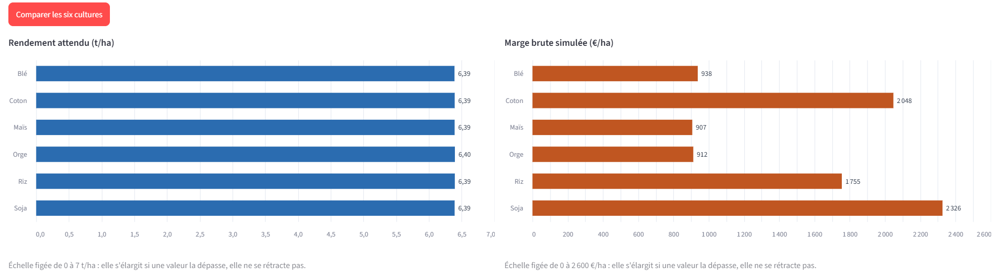
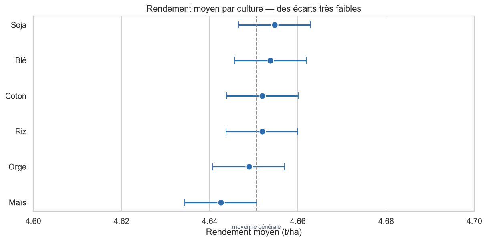
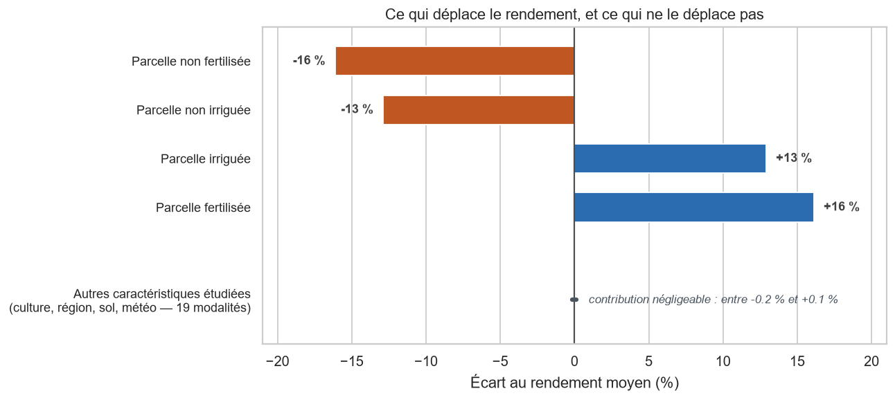
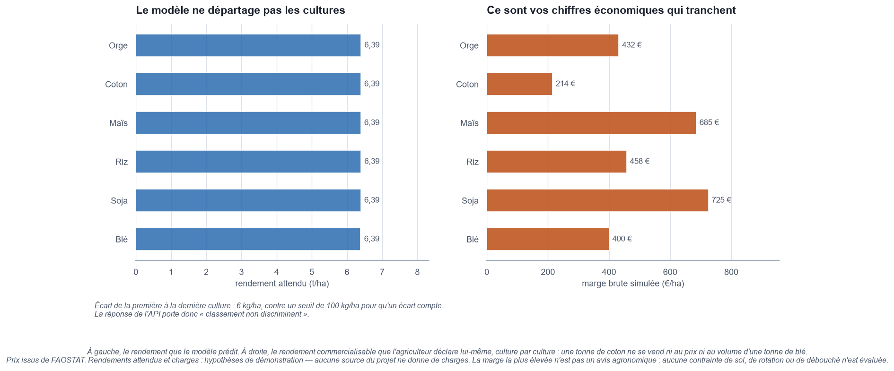
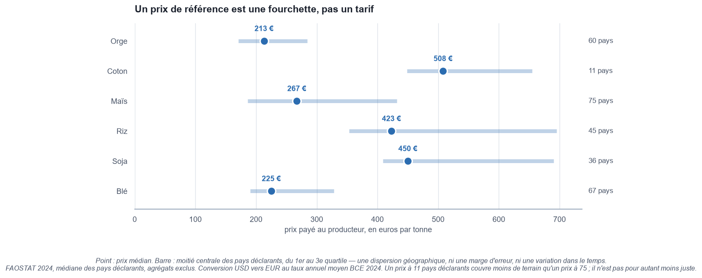
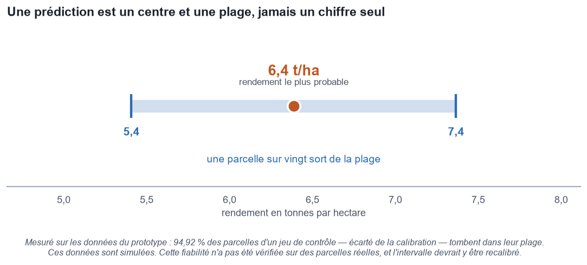

# Estimer un rendement, comparer six cultures

*Ce document présente les résultats de l'étude et ce qu'on peut en faire. Il se lit sans connaissance technique. Le détail de la méthode figure dans le rapport technique.*

---

## En bref

**Quatre choses à retenir.**

1. **Dans les données de cette étude, le modèle estime presque le même rendement pour les six cultures.** L'écart entre la meilleure et la pire tient en 6,5 kg par hectare. Les départager sur le rendement attendu n'a donc pas de sens ici.
2. **Trois facteurs principaux font varier le rendement** : la pluie d'abord, et de loin, puis la fertilisation et l'irrigation. La température joue, bien plus faiblement. Le type de sol, la région et la condition météo n'y changent rien de mesurable.
3. **C'est la marge qui départage les cultures.** À rendements égaux, ce sont les prix et les charges qui font la différence — et l'écart se compte en centaines d'euros par hectare.
4. **Un rendement estimé n'est jamais un chiffre seul.** L'outil annonce une fourchette, et c'est elle qui porte l'information utile.

> **Une réserve qui vaut pour tout ce document.** Les données d'étude sont **simulées**, non relevées au champ. Les chiffres ci-dessous décrivent fidèlement ce jeu de données ; ils ne constituent pas des résultats agronomiques transposables à une exploitation réelle.

---

## Ce que l'outil répond

L'application pose huit questions sur la parcelle — la pluviométrie de la saison, la température moyenne, si elle est fertilisée, si elle est irriguée, la culture envisagée, et trois caractéristiques facultatives : la région, le type de sol et la condition météo dominante.

Elle répond de deux façons.

**Le rendement attendu** d'une culture, avec la fourchette dans laquelle il devrait tomber.

**La comparaison des six cultures**, sur leur rendement d'abord, puis sur leur marge brute dès que les charges sont renseignées.

> **L'application ne prévoit pas la météo.** Elle répond à la question « *si la saison apporte cette pluie et cette température, quel rendement attendre ?* ». C'est un simulateur de scénario, pas une prévision de récolte. Au moment de semer, vous ne connaissez pas la pluviométrie de la saison à venir : l'usage prévu est d'essayer plusieurs hypothèses — une saison sèche, une saison normale, une saison humide — et de voir ce que chacune donnerait.

*Les six barres de gauche sont les rendements estimés : elles sont égales à deux centièmes près. Les barres de droite sont les marges. Même parcelle, même estimation — c'est l'économie qui sépare les cultures.*

> **Ce que montre cette capture : l'état de départ.** Hypothèses : prix FAOSTAT, **rendement du modèle appliqué aux six cultures** — 6,39 t/ha — et charges d'exemple de l'interface. Que le modèle estime presque le même rendement pour les six est une limite de ce qu'il a appris sur des données simulées : ce n'est pas un rendement de référence par culture, et cela ne doit pas servir d'hypothèse de budget. Dès que vous déclarez le rendement que vous attendez réellement de chaque culture, les marges changent d'échelle et parfois d'ordre — c'est ce que montre la figure du **Résultat 3**, construite sur d'autres hypothèses.

---

## Résultat 1 — les six cultures ne se départagent pas

C'est le résultat le plus important de l'étude, et il va à l'encontre de ce qu'on attendait.

À conditions de parcelle rigoureusement identiques, nous avons demandé au modèle d'estimer les six cultures et mesuré l'écart entre la meilleure et la pire.

| Mesure | Valeur |
|---|---|
| Écart de rendement entre la meilleure et la pire culture | **6,5 kg/ha** |
| Soit, à 200 €/t | **1,29 €/ha** |
| Seuil à partir duquel un écart compte en pratique | **100 kg/ha** |
| Rapport de l'écart à ce seuil | **1 pour 15** |

*Ce graphique montre les **rendements moyens observés** dans les données, avec leur marge d'incertitude. Attention à l'échelle : elle couvre un dixième de tonne par hectare, et les six cultures y tiennent toutes. Les 6,5 kg/ha du tableau ci-dessus sont une **autre mesure** — l'écart entre les estimations du modèle à conditions de parcelle rigoureusement identiques. Les deux disent la même chose : qu'on observe ou qu'on estime, l'écart reste très en deçà des 100 kg/ha retenus comme seuil. L'argument ne repose pas sur le recouvrement des barres, qui ne prouverait aucune équivalence statistique.*

Ce seuil de 100 kg/ha est une **convention retenue pour cette étude**, et annoncée comme telle. Ce n'est ni une norme agronomique, ni une limite de précision des pesées : c'est l'ordre de grandeur en deçà duquel nous avons décidé qu'un écart ne mériterait pas d'orienter une décision, une fois considérées l'humidité, les pertes au battage et l'hétérogénéité d'une parcelle. Un écart quinze fois plus petit que ce seuil ne pèse rien dans un budget prévisionnel.

Nous avons cherché un effet caché de plusieurs manières — à type de sol fixé, à météo fixée, à région fixée, par tranche de pluviométrie, par tranche de température. Aucun n'apparaît. Et retirer purement et simplement l'information « culture » du modèle ne dégrade pas ses estimations.

**Ce que cela signifie.** L'outil ne peut pas conseiller une culture plutôt qu'une autre sur la seule base du rendement. Il le dit lui-même à l'écran plutôt que d'afficher un classement qui ne serait que du bruit.

**Ce que cela ne signifie pas.** Que les cultures se valent en agriculture réelle. Cela signifie que **ces** données, simulées, ne portent aucune trace exploitable d'une différence.

---

## Résultat 2 — ce qui fait varier le rendement

Trois facteurs principaux concentrent l'essentiel de ce qui fait bouger le rendement dans ces données, auxquels s'ajoute la température, d'effet nettement plus faible. Les neuf autres informations collectées pèsent quelques kilogrammes par hectare — c'est-à-dire rien.

| Facteur | Écart de rendement associé | Équivalent à 200 €/t |
|---|---|---|
| **Pluviométrie** | +5 kg/ha par millimètre | +1 €/ha par mm |
| **Fertilisation** | **+1,50 t/ha** | **+300 €/ha** de produit brut |
| **Irrigation** | **+1,20 t/ha** | **+240 €/ha** de produit brut |
| **Température** | +20 kg/ha par degré | +4 €/ha par °C |

*Quatre barres se détachent : fertiliser et irriguer, dans un sens comme dans l'autre. La ligne du bas résume les dix-neuf autres situations étudiées — type de sol, région, météo, culture : aucune ne déplace le rendement de plus de 0,2 % de la moyenne.*

**La pluie est le premier facteur, et de loin.** Son effet unitaire paraît faible, mais elle varie de 100 à 1 000 mm dans les données. D'un extrême à l'autre, cela représente **4,5 t/ha, soit 900 €/ha**. C'est aussi le seul facteur sur lequel personne n'a de prise — d'où l'importance des deux suivants.

**Dans ces données, fertiliser et irriguer sont les deux seuls leviers sur lesquels vous ayez prise**, et ils sont du même ordre : 300 et 240 €/ha de produit brut.

> **Produit brut, pas bénéfice.** Ces montants sont des **écarts de produit brut estimés** sur les données simulées de l'étude, pas ce que la pratique laisse. Fertiliser et irriguer coûtent, et ces coûts ne figurent dans aucune des données de l'étude. L'arbitrage « est-ce rentable chez moi ? » suppose de connaître le prix de ses intrants et de son eau. L'outil ne le fait pas à votre place.

> **Un écart observé n'est pas un effet garanti.** Dans ces données, les parcelles fertilisées et non fertilisées ne diffèrent par rien d'autre — pluie, température et durée de cycle y sont identiques à 0,13 % près. La lecture en termes de levier est donc défendable **ici**. Elle ne le serait pas sur des relevés de terrain, où les parcelles fertilisées diffèrent souvent par bien d'autres aspects.

---

## Résultat 3 — c'est la marge qui sépare les cultures

Puisque les six rendements sont équivalents, la différence se joue ailleurs : sur ce que chaque culture rapporte, et sur ce qu'elle coûte à conduire.

L'application calcule donc une **marge brute** :

> **Marge brute (€/ha) = Prix (€/t) × Rendement (t/ha) - Charges opérationnelles (€/ha)**

C'est l'indicateur que retiennent la FAO et le réseau d'information comptable agricole européen pour comparer des cultures entre elles. **Ce n'est pas un bénéfice** : il sert à départager des hypothèses, pas à mesurer ce que rapporte une parcelle. Il ne soustrait que les charges opérationnelles — semences, engrais, traitements, irrigation, travaux par tiers. Les charges fixes en sont exclues parce qu'elles sont engagées **avant** le choix de la culture : elles pèsent sur le résultat de l'exploitation, pas sur le départage des six options.

*À gauche, les six cultures à conditions identiques : six barres indiscernables, 6,39 t/ha partout. À droite, les marges : de 214 €/ha pour le coton à 725 €/ha pour le soja, soit un rapport de 1 à 3,4. Même parcelle, même modèle — c'est l'économie qui sépare les cultures, pas l'agronomie.*

*Hypothèses de cette figure, différentes de celles de la capture page 3 : prix FAOSTAT, **rendements commercialisables déclarés culture par culture** — 1,8 t/ha pour le coton, 5,0 pour le maïs — et charges déclarées. C'est ce changement de rendements, et lui seul, qui explique que les deux illustrations ne donnent ni les mêmes montants ni le même ordre.*

### Les prix servis par l'application

Aucune des données de l'étude ne contient de prix. Ceux que l'application propose viennent donc de l'extérieur : **FAOSTAT**, l'organisation statistique des Nations unies pour l'alimentation et l'agriculture — prix à la production, année 2024, convertis en euros.

| Culture | Prix médian | Moitié centrale des pays déclarants | Pays déclarants |
|---|---|---|---|
| Orge | 213 €/t | 171 - 284 | 60 |
| Coton *(graine non égrenée)* | 508 €/t | 449 - 655 | 11 |
| Maïs | 267 €/t | 186 - 432 | 75 |
| Riz | 423 €/t | 353 - 695 | 45 |
| Soja | 450 €/t | 409 - 690 | 36 |
| Blé | 225 €/t | 190 - 328 | 67 |

*La barre couvre la moitié centrale des pays déclarants. Ce n'est pas une marge d'erreur, c'est une dispersion géographique : le riz s'étale de 353 à 695 €/t selon le pays.*

Ce sont des **médianes mondiales**, pas des prix français. Leur assise varie beaucoup — 11 pays déclarants pour le coton, 75 pour le maïs. Elles servent à amorcer la saisie, pas à se substituer au prix réellement obtenu.

### Les charges, c'est vous qui les donnez

L'application propose des valeurs par culture pour que le tableau ne s'ouvre pas vide. **Ce sont des exemples, pas des références** : ils n'ont aucune source, ils sont seulement hiérarchisés par intensité connue — coton et riz irrigué en tête, céréales à paille en bas.

Tant qu'aucune charge n'a été modifiée, l'application refuse de présenter le classement obtenu comme un résultat. Elle affiche à la place : *« Classement obtenu sur les charges d'exemple : aucune n'a été modifiée. Il illustre le calcul, il ne conseille rien. »*

---

## Résultat 4 — un rendement se lit avec sa fourchette

L'application n'affiche jamais un rendement seul. Elle l'encadre d'une plage, et cette plage est aussi importante que le chiffre.

*Le repère marque l'estimation centrale, la barre la fourchette indicative qui l'accompagne. Un chiffre seul se lirait comme une promesse.*

La fourchette vaut **± 0,98 t/ha** autour de l'estimation. Elle a été calibrée sur un jeu de données, puis **vérifiée sur un autre**, tenu à l'écart : sur celui-ci, 94,9 % des parcelles tombaient bien dans la plage annoncée, pour 95 % visés. Elle tient aussi culture par culture, aux pluviométries extrêmes, et sur les parcelles sèches sans intrants.

C'est une fourchette pour **une** parcelle, pas pour la moyenne d'un ensemble de parcelles — cette seconde serait beaucoup plus étroite, et répondrait à une autre question.

Hors du domaine observé — en dessous de 100 mm ou au-dessus de 1 000 mm de pluie, en dessous de 15 °C ou au-dessus de 40 °C — l'application **avertit**. Elle ne refuse pas de répondre : une saison plus humide que toutes celles observées reste une question légitime. Mais la fiabilité de la réponse n'y a pas été mesurée.

---

## Les variables clés, expliquées

| Ce que l'application demande | Ce que c'est | Son poids sur le rendement | Avez-vous la main dessus ? |
|---|---|---|---|
| **Pluviométrie** | la pluie reçue sur la saison, en mm | le plus fort de tous : 4,5 t/ha entre 100 et 1 000 mm | non |
| **Fertilisation** | la parcelle a-t-elle reçu un apport ? | +1,50 t/ha | **oui** |
| **Irrigation** | la parcelle est-elle irriguée ? | +1,20 t/ha | **oui** |
| **Température** | la température moyenne de la saison | +20 kg/ha par degré | non |
| **Culture** | celle que vous envisagez | quelques kg/ha : elle ne départage rien | oui, mais sans effet mesurable |
| Région | zone générique du jeu d'étude | 2 kg/ha | — |
| Type de sol | argileux, sableux, calcaire… | 3 kg/ha | — |
| Condition météo | ensoleillé, nuageux, pluvieux | 0,5 kg/ha | — |

Les trois dernières sont **facultatives**. Les omettre déplace l'estimation de 1,7 kg/ha en moyenne — autant dire rien. Elles sont conservées dans le formulaire parce qu'elles comptent en agronomie réelle, et qu'un jeu de données observées pourrait leur donner le poids que celui-ci ne leur donne pas.

**Cinq autres variables ne vous sont jamais demandées**, et c'est délibéré : l'application les calcule à partir de vos réponses. Les exposer permettrait de décrire une parcelle impossible — 800 mm de pluie, irriguée, et pourtant déclarée en situation de sécheresse sans irrigation.

---

## Pourquoi l'application ne demande pas l'usage de pesticides

La question se pose, puisque la demande initiale la mentionnait. Trois raisons, dans cet ordre.

**Les données de parcelles n'en contiennent aucune trace.** Aucune des 999 769 parcelles de l'étude ne dit si elle a été traitée, ni avec quoi. Le modèle n'a donc jamais rencontré cette information : lui poser la question ne changerait rien à sa réponse.

**La seule donnée disponible n'est pas une pratique, c'est un tonnage national.** Le référentiel FAO fournit un volume de pesticides par pays et par année. Cette valeur est **identique pour les quatre cultures** d'un même pays la même année : elle ne peut, par construction, distinguer le blé du riz. Et elle n'est renseignée que pour 45 % des observations.

**Sa relation avec le rendement est trop faible pour être exploitée**, et le sens du lien resterait de toute façon indéterminé : un pays qui produit beaucoup traite beaucoup. Le détail de la mesure figure au rapport technique.

**Ce que cela ne dit pas.** Que la protection des cultures soit sans effet agronomique. Cela dit que les données de cette étude ne permettent ni de le mesurer, ni de le conseiller — et que demander une information inexploitable ferait croire qu'elle influence la réponse.

---

## Recommandations

**1. N'attendez pas du rendement qu'il départage les cultures.** Dans ce prototype, les six estimations sont trop proches pour cela, et l'application vous le dira. La comparaison des marges sert alors à explorer des scénarios de prix et de charges — c'est une aide au raisonnement, pas un plan d'assolement.

**2. Reprenez les trois colonnes du tableau, pas seulement les charges.** Elles sont toutes les trois modifiables, et chacune a une origine différente : le **prix** vient de FAOSTAT — une médiane mondiale, pas votre prix ; le **rendement attendu** est celui du modèle, identique pour les six cultures tant que vous ne l'avez pas corrigé ; les **charges** sont des exemples qui ne sont la donnée de personne. Le classement dépend des trois. Tant que les charges d'exemple n'ont pas été touchées, l'application signale que le résultat affiché n'est qu'une illustration du calcul.

**3. Confrontez l'écart observé au coût réel de la pratique.** Dans ces données, les parcelles fertilisées montrent un rendement estimé supérieur de 300 €/ha de produit brut, les parcelles irriguées de 240 €/ha. Ce ne sont pas des gains promis : ce sont des écarts mesurés sur un jeu simulé. Et ce qu'il vous en coûterait — engrais, eau, passages — ne figure nulle part dans l'outil. L'arbitrage reste le vôtre, et ces deux chiffres n'en sont que la moitié.

**4. Lisez la fourchette, pas le point.** Un rendement annoncé à 6,4 t/ha s'accompagne d'une fourchette de 5,4 à 7,4 — une plage indicative, dont la fiabilité a été mesurée sur les données simulées de l'étude. Un budget construit sur la borne haute est un budget optimiste.

**5. Méfiez-vous des conditions extrêmes.** Au-delà de 1 000 mm de pluie ou de 40 °C, l'outil répond mais prévient : il n'a jamais rien vu de tel, et la fiabilité annoncée n'y vaut plus.

**6. N'attendez pas un conseil adapté à votre parcelle.** Le gain attribué à la fertilisation est **le même partout** dans ce modèle : il ne dit pas qu'il faudrait fertiliser davantage une parcelle pauvre qu'une parcelle riche. Un tel conseil demanderait un modèle différent et, surtout, des données réelles.

---

## Ce que l'outil ne dit pas

**Il ne remplace pas une observation de terrain.** Les données d'étude sont simulées. Elles ont permis de construire et de valider toute la chaîne, de la donnée à l'écran, mais elles ne décrivent aucune parcelle existante.

**Il ne démontre pas de causalité.** Qu'une parcelle fertilisée rende davantage dans ces données ne prouve pas qu'épandre de l'engrais chez vous relèverait votre rendement d'autant.

**Il ne dit pas quelle culture est la plus rentable pour votre exploitation.** Il dit laquelle présente la meilleure marge brute **parmi celles que vous avez renseignées**, sur **une** campagne, avec **vos** charges et un prix de référence mondial. Un assolement se raisonne en rotation, sur plusieurs années, avec des contraintes que l'outil ignore.

**Il n'a pas été validé sur des exploitations réelles.** C'est la condition dont dépendent toutes les autres : un entraînement sur des relevés de terrain changerait la nature même de ce qu'il peut affirmer.

---

## Conclusion

Agritech Answers estime le rendement d'une parcelle à partir de ses conditions et de vos pratiques, puis compare six cultures sur leur marge brute une fois vos charges renseignées.

**Ce que le projet démontre.** La chaîne fonctionne de bout en bout, de la donnée brute à l'écran, et chaque chiffre affiché reste rattachable à ce qui l'a produit. L'outil annonce lui-même ce qu'il ne sait pas départager plutôt que d'afficher un classement de bruit.

**Ce qu'il ne démontre pas.** Qu'un conseil tiré de ces estimations tiendrait au champ. Les parcelles qui ont servi à l'entraînement sont simulées, et aucun résultat chiffré de ce rapport n'est transposable à une exploitation réelle.

**Ce qu'il faudrait pour aller plus loin.** Des relevés de terrain à la place des données simulées, et des références de charges adaptées aux exploitations concernées. Puis une validation sur des exploitations réelles, et un examen de la faisabilité agronomique des cultures comparées. Aucune de ces conditions ne suffit seule, et c'est seulement une fois les quatre réunies que ce prototype deviendrait une aide à la décision.
