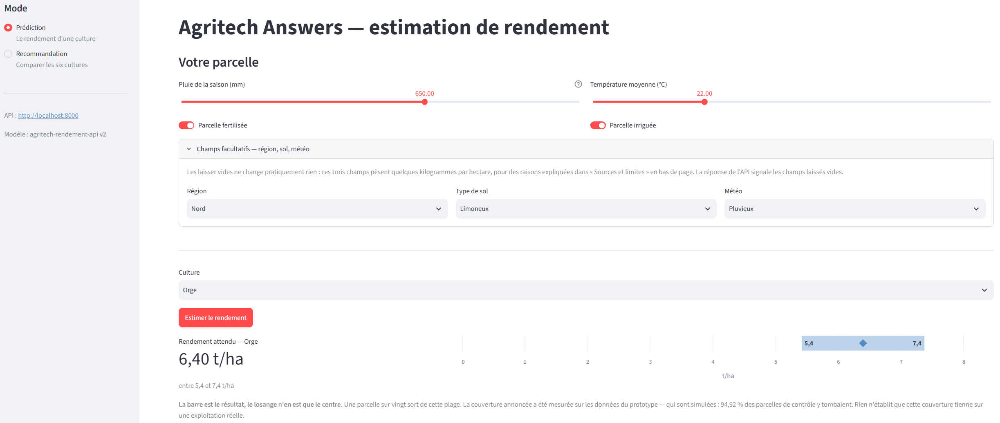
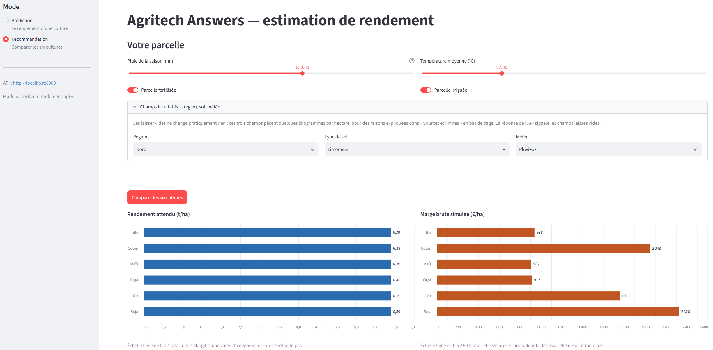
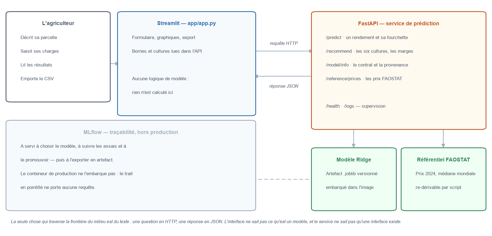

# Étape 4 — L'interface Streamlit : ce que l'agriculteur voit, et ce qu'on l'empêche de croire

*Document de travail destiné à alimenter le rapport métier final.*

*Les sections 1 à 6 décrivent l'écran et les décisions de présentation : elles se lisent sans connaissance technique. Les sections 7 à 10 portent sur l'architecture, la traçabilité et les tests, et s'adressent à qui reprendra l'application.*

---

## 1. Ce que cette étape devait livrer

L'étape 3 s'était arrêtée sur un service qui répondait correctement — mais auquel il fallait parler en JSON. Cette étape pose une interface par-dessus, sans rien ajouter au modèle ni à l'API.

| Livrable | Contenu |
|---|---|
| **Application** | `app/app.py` — 833 lignes, un seul fichier, deux parcours |
| **Dépendances** | `app/requirements.txt` — 40 paquets, exportés depuis `uv.lock` |
| **Tests** | `tests/test_app.py` — **44 tests**, 7 secondes, sans jamais joindre l'API |
| **Couverture** | **99 %** de `app/app.py`, branches comprises |

Le cahier des charges demandait `app.py` et `requirements.txt`. Le reste — tests, panneau de traçabilité, export — relève du choix de projet, pas de l'obligation.

---

## 2. La règle qui gouverne tout le fichier : l'interface ne calcule rien

Aucune logique métier ne figure dans `app.py`. Pas de modèle, pas de seuil, pas de règle de dérivation. Même ce qu'on serait tenté de considérer comme du décor vient de l'API :

| Ce qui s'affiche | D'où ça vient |
|---|---|
| La liste des six cultures | `accepted_values.Crop` de `/model/info` |
| Les bornes des curseurs — 100 à 1000 mm, 15 à 40 °C | `training_domain` de `/model/info` |
| Le rendement et sa fourchette | `/predict` |
| Le classement et ses réserves | `/recommend` |
| Les prix de référence | `/reference/prices` |

La raison n'est pas esthétique. Recopier ces valeurs créerait un second endroit où une divergence peut s'installer — une interface qui proposerait une culture que le modèle ne connaît plus, ou un curseur qui autoriserait une saisie que l'API refusera. Si le modèle était réentraîné sur un domaine plus large, l'écran suivrait sans qu'une ligne change. Un test le vérifie explicitement.

**La seule exception est assumée et signalée** : les charges opérationnelles d'exemple (section 4). Ce sont des repères de saisie, pas des données, et tout ce qui les entoure le répète.

---

## 3. Les deux parcours

### 3.1 Prédiction — une culture, un rendement, une fourchette

L'agriculteur décrit sa parcelle — pluie de la saison, température moyenne, fertilisation, irrigation — choisit une culture, et obtient un chiffre.

Ce chiffre n'est jamais seul. À côté, une barre horizontale montre l'intervalle à 95 %, avec l'estimation posée dessus en losange. Ce choix de présentation répond à un constat simple : *« entre 5,4 et 7,4 t/ha »* écrit dans une phrase se lit comme une précision, alors qu'une barre se lit comme une incertitude. L'axe est ancré à zéro — sans cela, une plage étroite paraîtrait large.

La légende rattache la couverture annoncée à ce qui l'a mesurée : 94,92 % des parcelles de contrôle tombaient dans l'intervalle, **sur des données simulées**. Rien n'établit que cette couverture tienne sur une exploitation réelle.

*Capture de l'application en fonctionnement. Le chiffre en gras est l'estimation ; la barre bleue est l'intervalle à 95 %, borné à ses deux extrémités, et le losange marque l'estimation à l'intérieur. La phrase sous le graphique rattache la couverture annoncée aux données qui l'ont mesurée.*

### 3.2 Recommandation — en deux temps, et jamais un seul

Le premier temps compare les six cultures sur le rendement attendu. Le second seulement, une fois les charges renseignées, calcule les marges.

Cette séparation n'est pas de confort. Sur les données du prototype, les six rendements prédits sont pratiquement identiques — l'écart entre la meilleure et la pire culture tient dans quelques kilogrammes. L'API le signale elle-même (`ranking_discriminative: false`) et l'écran relaie l'avertissement. **Un classement par rendement seul ne départagerait rien** ; c'est l'économie qui décide, et l'économie demande des charges.

Les deux panneaux — rendement à gauche, marge à droite — partagent un **ordre alphabétique figé**, qui ne dépend pas des valeurs. Trier chacun par sa grandeur interdirait la lecture horizontale, et en interactif les barres sauteraient à chaque charge modifiée.

**L'échelle est figée elle aussi** : elle s'élargit quand une valeur la dépasse, et ne se rétracte jamais. Sans cela, l'axe se recalerait sur chaque réponse et une marge en baisse réoccuperait la même largeur qu'avant — l'utilisateur verrait un changement de chiffres sans voir de changement. Le zéro reste toujours dans le cadre, et le bas descend si une marge devient négative : des charges supérieures au produit brut doivent se voir, et non disparaître en barre nulle.

*Capture de l'application en fonctionnement. **Les six barres de gauche sont égales à deux centièmes près** — 6,39 t/ha partout, 6,40 pour l'orge : le rendement ne départage rien. Les marges de droite, elles, s'étalent de 907 à 2 326 €/ha, et c'est la saisie des charges qui produit cet écart. Sous chaque graphique, la légende rappelle l'échelle retenue, pour que la capture reste lisible hors de l'écran.*

---

## 4. Les charges : pourquoi l'écran en propose, et pourquoi il s'en méfie

Aucun des deux jeux de données du projet ne contient de charges opérationnelles. L'interface en affiche pourtant, différentes selon la culture, pour que le tableau ne s'ouvre pas vide.

**Ce sont des ordres de grandeur sans source**, hiérarchisés par intensité connue : coton et riz irrigué en tête, céréales à paille en bas. Trois raisons de les différencier plutôt que de poser une valeur commune :

1. les six rendements prédits sont identiques, donc des charges égales feraient du classement des marges une simple recopie du classement des prix ;
2. des charges européennes combinées aux prix mondiaux FAO donnent des marges négatives sur trois cultures sur quatre — c'est mesuré, et consigné dans `config.py` ;
3. une valeur unique se lirait comme une moyenne de référence.

Trois garde-fous accompagnent cet affichage :

| Où | Ce qui est dit |
|---|---|
| Bandeau au-dessus du tableau | « Les charges affichées sont des exemples, pas des références » |
| En-tête de colonne | « Charges (€/ha) · **exemple à remplacer** » |
| Au-dessus du classement obtenu | « Classement obtenu **sur les charges d'exemple** : aucune n'a été modifiée. Il illustre le calcul, il ne conseille rien. » |

Le troisième est le plus important : l'application compare le tableau rendu au tableau proposé, et tant qu'aucune charge n'a été touchée, elle refuse de laisser passer le classement pour un résultat. Vider une case compte comme une intervention — c'est un retrait délibéré de la culture, pas un oubli, et cette culture sort de la comparaison sans recevoir une marge nulle.

### Comparer deux scénarios sans tout ressaisir

Basculer la fertilisation ou l'irrigation puis relancer la comparaison **met à jour les rendements, conserve les charges déjà saisies, et recalcule les marges dans le même geste**. Les deux panneaux bougent ensemble, en un clic.

C'est précisément l'effet qu'on cherche à mesurer, et il a fallu deux essais pour le rendre : une première version effaçait les marges devenues caduques — au motif, juste, que les laisser à l'écran à côté de rendements neufs les ferait passer pour un résultat à jour. Mais l'utilisateur se retrouvait alors renvoyé au bouton « Calculer les marges » à chaque bascule, et le panneau de droite redemandait des charges déjà présentes. **Le bon comportement n'était ni de garder ni d'effacer : c'était de refaire.** L'application relance donc le calcul économique sur les charges en place, et ne redemande rien.

---

## 5. La marge brute : la formule, et pourquoi c'est celle-là

La formule est affichée avant le tableau de saisie, pas après :

> **Marge brute (€/ha) = Prix (€/t) × Rendement (t/ha) − Charges opérationnelles (€/ha)**

C'est l'indicateur que la **FAO** et le **RICA européen** retiennent pour comparer des cultures entre elles. Il ne soustrait que les charges opérationnelles — semences, engrais, traitements, irrigation, travaux par tiers. Les charges fixes — matériel, foncier, main-d'œuvre permanente — en sont exclues **parce qu'elles sont engagées avant le choix de la culture** : elles pèsent sur le résultat de l'exploitation, pas sur le départage des six options.

| Source | Définition retenue |
|---|---|
| Glossaire FAO | marge brute = valeur de production − charges variables |
| NSW DPI, *About gross margin budgets* | exclut amortissement, intérêts, taxes et main-d'œuvre permanente ; *« a gross margin is not profit »* |
| Règlement (CEE) 79/65 | marge brute standard = production brute standard − charges variables standard |

Aides et coproduits ne sont pas comptés. **Le chiffre obtenu classe des cultures ; il ne dit pas ce que rapporte la parcelle.**

---

## 6. Les champs facultatifs : ce que pèsent vraiment les variables

Région, type de sol et météo sont proposés en saisie facultative. Ils sont bien transmis au modèle : les 28 variables de l'artefact servi les contiennent toutes, encodées en indicatrices, avec des coefficients non nuls. Ils ne pèsent simplement rien.

Les indicatrices et les booléens étant sur une échelle 0/1, leur coefficient se lit directement comme une **contribution prédictive** en tonnes par hectare :

| Variable | Contribution dans ce modèle |
|---|---|
| Parcelle fertilisée | **+1,500 t/ha** |
| Parcelle irriguée | **+1,200 t/ha** |
| Pluie | **+0,005 t/ha par mm**, soit +4,5 t/ha sur la plage complète |
| Température | **+0,020 t/ha par °C** |
| Sol argileux — le plus fort des six sols | +0,0027 t/ha, soit **2,7 kg/ha** |
| Région Nord — la plus forte des quatre | +0,0022 t/ha, soit **2,2 kg/ha** |
| Météo pluvieuse — la plus forte des trois | +0,0005 t/ha, soit **0,5 kg/ha** |

> **Ce que ces chiffres sont, et ce qu'ils ne sont pas.** Ce sont les contributions d'un modèle linéaire entraîné sur des **données simulées**. Elles décrivent la relation que le modèle a reproduite à partir du générateur, **pas un effet causal agronomique** : que le modèle attribue +1,5 t/ha à la fertilisation ne démontre pas qu'épandre de l'engrais sur une parcelle réelle relèverait son rendement d'autant. De même, +0,005 t/ha par mm est une contribution linéaire valable dans la plage apprise, et non une loi agronomique valable à toutes les pluviométries.

Un facteur **500 à 2 500** sépare les deux groupes. Dans ce modèle, les trois champs facultatifs ont donc un **impact numérique négligeable** sur la prédiction. Ce constat porte sur ce Ridge et sur ces données ; il ne démontre pas qu'aucun signal n'existerait dans la réalité — région, sol et météo comptent en agronomie, mais rien dans les données disponibles ne permet au modèle de l'apprendre.

**Ce n'est pas un défaut du modèle**, et les quatre premières lignes l'indiquent : elles reproduisent au millième la formule du générateur identifiée à l'étape 2, qui ne fait intervenir que ces quatre variables. Il n'y a donc, dans ces données-ci, rien à apprendre pour les trois autres — et rien ne changera tant que l'entraînement n'aura pas eu lieu sur des relevés réels. L'application l'écrit dans sa section « Sources et limites » plutôt que de laisser croire à une personnalisation qui n'existe pas.

Cette lecture apporte deux constats qui dépassent la question posée.

**La culture elle-même ne pèse pas davantage** : `Crop_Wheat` vaut −2,7 kg/ha, `Crop_Maize` +0,4 kg/ha. C'est l'explication mécanique du `ranking_discriminative: false` renvoyé par l'API et du classement non discriminant décrit en 3.2 — si les six indicatrices de culture valent quelques kilogrammes, les six rendements prédits ne peuvent qu'être identiques. Le constat était connu par les sorties ; il se lit désormais dans les poids.

**Les cinq variables dérivées non plus.** `crop_productivity_index`, `crop_yield_geo_cv`, `low_rain_no_irrigation` et les autres restent toutes sous le centième de tonne. La machinerie de dérivation construite à l'étape 3 existe parce que le modèle attend treize entrées là où l'agriculteur en saisit huit — pas parce que ces cinq variables pèsent sur la prédiction de cette version. Sans elle le modèle ne se charge pas ; avec elle, il ne prédit pas mieux.

> **Une précaution de lecture.** Comparer des coefficients bruts entre variables d'échelles différentes est normalement un piège. Il n'y en a pas pour la conclusion ci-dessus : 2,7 kg/ha contre un rendement moyen de 5 t/ha font 0,05 % quelle que soit la convention. En revanche on ne peut pas en déduire que la fertilisation « pèse plus » que la pluie — à échelle comparable, la pluie l'emporte largement, puisqu'elle parcourt 4,5 t/ha entre 100 et 1000 mm.

---

## 7. L'architecture : deux processus, un seul contrat

*Le modèle et les calculs économiques restent du côté de FastAPI ; l'interface ne fait que poser des questions et afficher des réponses. **MLflow est à l'écart du flux** : il a servi à choisir, suivre et promouvoir le modèle, mais le conteneur de production ne l'embarque pas — le trait en pointillé ne porte aucune requête.*

`app.py` est organisé en deux familles de fonctions, séparées par une frontière explicite :

- **au-dessus**, les fonctions HTTP — elles ignorent qu'une interface existe et se testent sans Streamlit ;
- **en dessous**, l'affichage.

C'est cette frontière qui rend les tests possibles sans second fichier. Le groupe de dépendances `ui` est lui aussi **disjoint du groupe `api`** : le front n'importe ni FastAPI ni le modèle, et les deux pourront donc être déployés séparément.

L'adresse du service se règle par la variable d'environnement `AGRITECH_API_URL`. Sans elle, l'application vise `http://localhost:8000` ; dans un `docker compose`, elle visera `http://api:8000`. C'est le point d'entrée prévu pour l'étape 5.

**Quand l'API ne répond pas**, l'écran dit quoi faire plutôt que d'afficher une trace : délai dépassé, service injoignable avec la commande de démarrage, ou champ refusé — dans ce dernier cas l'application nomme le champ en cause au lieu de recracher le JSON de validation.

---

## 8. La traçabilité : trois niveaux qu'il serait faux de confondre

Un panneau repliable « Informations techniques du modèle » expose ce que `/model/info` déclare, en **trois blocs distincts** :

| Bloc | Ce qu'il répond |
|---|---|
| **Ce que l'API sert en ce moment** | registre, version servie, mode de chargement, adresse du service |
| **D'où vient cet artefact** | algorithme, run MLflow, versions des données et du découpage, empreinte SHA-256, versions des bibliothèques |
| **Ce que le registre enregistrait à l'export** | alias, alias précédent, date de promotion |

La séparation est le point essentiel. **Déplacer l'alias `champion` dans MLflow ne change rien à un service déjà lancé** : l'image embarque un `.joblib`, et même en mode registre l'artefact est lu une seule fois, au démarrage. Un bouton « Relire les informations de l'API » vide le cache de cinq minutes de l'interface — il relit ce que l'API *déclare*, il ne recharge aucun modèle et ne promeut rien. La légende du bouton le dit en toutes lettres, sans quoi le panneau induirait en erreur exactement là où il prétend informer.

---

## 9. L'export : ce qu'on emporte

Un bouton de téléchargement produit un CSV du classement et des budgets évalués. Trois précautions y comptent plus que le tableau lui-même :

- **une culture non évaluée a une marge vide, jamais zéro** — une marge nulle se comparerait, une marge absente non ;
- **chaque colonne proposée est doublée d'une colonne d'origine**, qui distingue ce que l'application a suggéré (`FAOSTAT 2024`, `modèle`, `exemple de l'interface`) de ce que l'utilisateur a saisi ;
- **l'en-tête porte la version du modèle servi**, son run et son mode de chargement, sans quoi le fichier ne serait rattachable à rien une fois détaché de l'écran.

L'en-tête rappelle aussi la convention de marge, l'origine simulée des rendements, le caractère mondial des prix, et que le fichier documente une simulation — pas un conseil agronomique validé. Séparateur `;` et virgule décimale, pour un tableur configuré en français.

---

## 10. Ce qui a été vérifié

Un script Streamlit ne se teste pas en le regardant tourner : les pannes qui comptent — API éteinte, délai dépassé, saisie refusée — n'arrivent jamais pendant une démonstration. Elles arrivent chez l'utilisateur.

Les tests s'appuient sur `streamlit.testing.v1.AppTest`, le banc d'essai officiel, qui exécute réellement `app.py` et rapporte toute exception. Le faux serveur est posé sur le module `requests` lui-même, donc il vaut aussi pour le script exécuté par `AppTest`. **Aucun de ces tests ne joint l'API** : ils doivent passer en intégration continue, où aucun conteneur ne tourne.

| Ce qui est couvert | Nombre |
|---|---|
| Appels HTTP et traduction des pannes | 11 |
| Parcours de prédiction et de recommandation | 9 |
| Tableau de budgets, fusion des rendements, charges d'exemple | 11 |
| Export CSV et panneau de traçabilité | 6 |
| Formules, alertes et classements | 7 |
| **Total** | **44 tests, 7 secondes** |

| Fichier | Couverture de branches |
|---|---|
| `app/app.py` | **99 %** |
| Total du projet (API, noyau, interface) | **97 %**, 144 tests |

Trois comportements de Streamlit ont dû être établis par lecture du code source ou par l'essai, et non par supposition :

- le script utilisateur s'exécute bien avec `__name__ == "__main__"`, ce qui permet à `main()` de partir sous `streamlit run` et de rester muet à l'import ;
- `st.cache_data` **survit d'un test à l'autre** dans un même processus — une panne de l'API restait invisible jusqu'à cinq minutes, et une fixture vide désormais le cache avant chaque test ;
- `st.data_editor` n'applique les styles `pandas.Styler` **qu'aux colonnes non modifiables**, ce qui interdit de colorer la cellule des charges et explique que le signal soit porté par ce qui entoure le tableau.

---

## 11. Limites portées à l'étape suivante

| Limite | Ce qu'elle appelle |
|---|---|
| L'interface et l'API se lancent à la main, séparément | un `docker compose` où le front vise `http://api:8000` |
| `app/requirements.txt` est exporté manuellement depuis `uv.lock` | un contrôle de dérive en intégration continue |
| Rien ne vérifie automatiquement que l'alias du registre et l'artefact servi concordent | le même contrôle, côté API |
| Les charges d'exemple n'ont aucune source | des références technico-économiques territorialisées, si le projet quitte le prototype |
| Région, sol et météo sont sans effet, la culture et les cinq variables dérivées non plus (section 6) | un entraînement sur des relevés réels — c'est la limite dont dépendent toutes les autres |
